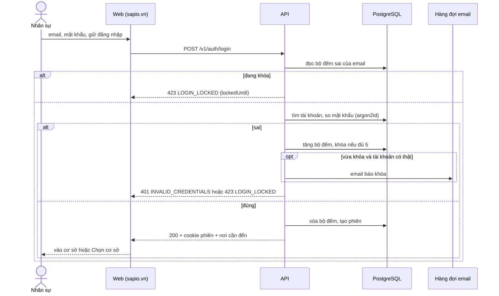
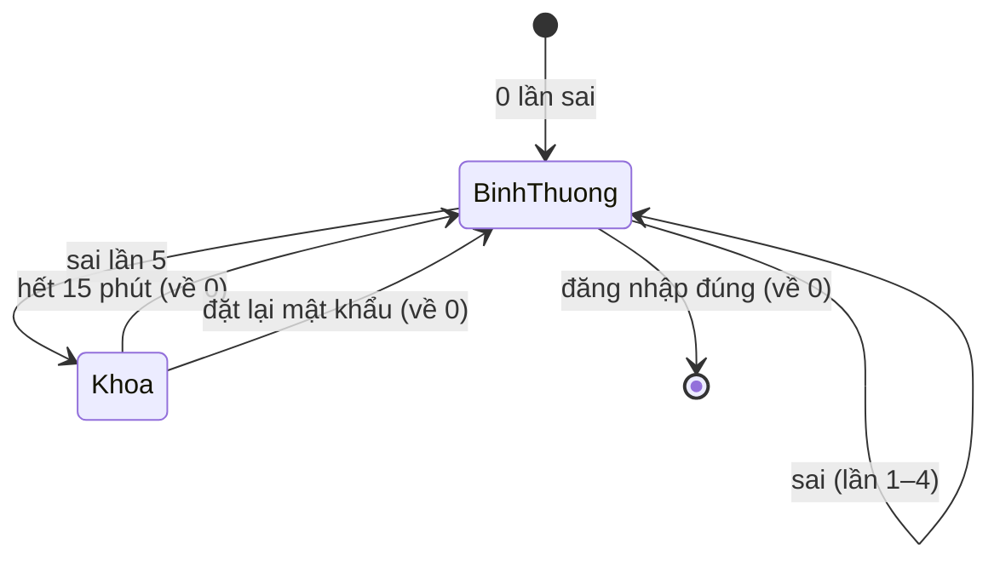

## Phạm vi

| Có trong tính năng này | Ở tính năng khác |
|---|---|
| Đăng nhập nhân sự (MH-03) và quản trị nền tảng (MH-63) | Đăng ký cơ sở, xác thực email (MH-02, BR-74) |
| Phiên, đăng xuất | Lời mời nhân sự (MH-05, BR-78) |
| Khóa tạm khi sai nhiều lần | Đăng nhập khách bằng mã email (MH-16, BR-16, BR-17) |
| Quên và đặt lại mật khẩu (MH-04) | Trang cơ sở bị khóa, hết gói (BR-79, BR-82) |
| Vào cơ sở sau khi đăng nhập, Chọn cơ sở (MH-06) | |

## Khái niệm

| Tên | Trong code | Nghĩa |
|---|---|---|
| Tài khoản | `user` | Một email, một mật khẩu. Một người làm ở nhiều cơ sở vẫn chỉ có một tài khoản |
| Thành viên | `membership` | Tài khoản có một vai trò ở một cơ sở |
| Cửa đăng nhập | `door`: `staff`, `platform` | `staff` là `sapio.vn/login`, `platform` là `admin.sapio.vn/login` (T-18). Tài khoản quản trị nền tảng chỉ vào cửa `platform`, tài khoản khác chỉ vào cửa `staff` |
| Phiên | `session` | Một lần đăng nhập trên một trình duyệt. Có hạn, thu hồi được |
| Bộ đếm sai | `login_throttle` | Số lần sai liên tiếp và thời điểm hết khóa của một email |
| Link đặt lại | `password_reset` | Link trong email quên mật khẩu |

Email luôn được **chuẩn hóa** trước khi so và lưu: bỏ khoảng trắng hai đầu, đổi sang chữ thường.

## Quy tắc

### BR-73. Mật khẩu

| Mã | Quy tắc |
|---|---|
| BR-73.1 | Dài từ **15** đến **128** ký tự, đếm theo ký tự Unicode sau khi chuẩn hóa NFC |
| BR-73.2 | Nhận mọi ký tự, kể cả dấu cách và tiếng Việt có dấu. Không ép phải có chữ hoa, số hay ký hiệu |
| BR-73.3 | Không được nằm trong danh sách mật khẩu phổ biến (so không phân biệt hoa thường) |
| BR-73.4 | Không bắt đổi định kỳ. Ô nhập cho dán, có nút hiện hoặc ẩn |
| BR-73.5 | Chỉ kiểm khi **đặt** mật khẩu (đăng ký, đặt lại, nhận lời mời). Đăng nhập không kiểm độ dài |

### BR-76. Đăng nhập và khóa tạm

| Mã | Quy tắc |
|---|---|
| BR-76.1 | Sai email, sai mật khẩu, hoặc đăng nhập sai cửa đều báo **cùng một câu** và cùng mã lỗi. Không để lộ email có tài khoản hay không |
| BR-76.2 | Đếm số lần sai **liên tiếp** theo email, chung cho cả hai cửa. Email không có tài khoản cũng đếm như thường |
| BR-76.3 | Từ lần sai thứ 3, câu báo kèm số lần còn lại trước khi bị khóa: còn 2, còn 1 |
| BR-76.4 | Lần sai thứ **5** khóa email đó **15 phút**, tính từ lần sai này |
| BR-76.5 | Trong lúc khóa, mọi lần đăng nhập email đó đều bị từ chối, kể cả khi đúng mật khẩu. Các lần này không đếm và không kéo dài thời gian khóa |
| BR-76.6 | Khi bắt đầu khóa, gửi một email báo cho chủ tài khoản, kèm giờ hết khóa và nút đặt lại mật khẩu. Email không có tài khoản thì không gửi gì, nhưng màn hình vẫn báo y hệt |
| BR-76.7 | Hết khóa thì bộ đếm về 0. Đăng nhập đúng cũng đưa bộ đếm về 0 |
| BR-76.8 | Đặt lại mật khẩu xong (BR-77.5) thì mở khóa ngay |

### Phiên

| Mã | Quy tắc |
|---|---|
| BR-76.9 | Cửa `staff`, không chọn "Giữ đăng nhập": phiên hết khi đóng trình duyệt, hoặc **12 giờ** sau lúc đăng nhập |
| BR-76.10 | Cửa `staff`, có chọn "Giữ đăng nhập": phiên giữ **30 ngày** tính từ lần dùng gần nhất |
| BR-76.11 | Cửa `platform`: không có "Giữ đăng nhập". Phiên hết khi đóng trình duyệt, hoặc sau **2 giờ** không thao tác |
| BR-76.12 | Đăng xuất thu hồi phiên ngay, ở cả máy chủ. Cookie cũ dùng lại cũng không vào được |

### BR-77. Quên và đặt lại mật khẩu

| Mã | Quy tắc |
|---|---|
| BR-77.1 | Gửi yêu cầu luôn nhận **cùng một câu**, dù email có tài khoản hay không. Email không có tài khoản, hoặc là tài khoản quản trị nền tảng, thì không gửi gì |
| BR-77.2 | Link dùng được **một lần** và hết hạn sau **30 phút** |
| BR-77.3 | Gửi lại được sau **60 giây**. Yêu cầu trong 60 giây đó vẫn nhận cùng câu báo nhưng không gửi email. Link mới làm mọi link cũ của tài khoản hết hiệu lực |
| BR-77.4 | Mật khẩu mới theo BR-73 |
| BR-77.5 | Đặt xong thì: thu hồi **mọi** phiên của tài khoản, mở khóa (BR-76.8), đăng nhập ở trình duyệt đang dùng (không giữ đăng nhập), rồi vào cơ sở dùng gần nhất (bảng dưới, cột "Sau khi đặt lại") |
| BR-77.6 | Link đã dùng, đã hết hạn hoặc đã bị thay đều mở ra cùng một trang "Link không còn dùng được", có nút gửi link mới |

### Vào cơ sở sau khi đăng nhập (một phần của BR-79)

| Tài khoản thuộc | Sau khi đăng nhập | Sau khi đặt lại mật khẩu |
|---|---|---|
| 0 cơ sở | Chọn cơ sở (MH-06), danh sách trống, có nút "Đăng ký cơ sở của riêng bạn" | như cột trái |
| 1 cơ sở vào được | Trang đầu theo vai trò: Lịch, hoặc Lịch của tôi với kỹ thuật viên | như cột trái |
| 1 cơ sở tạm dừng (nhân viên của cơ sở hết gói) | Chọn cơ sở | như cột trái |
| Nhiều cơ sở | Chọn cơ sở, cơ sở dùng gần nhất có nhãn | Cơ sở dùng gần nhất nếu vào được, nếu không thì Chọn cơ sở |

Chủ cơ sở hết gói vào thẳng trang Gói Sapio. Cơ sở bị khóa mở trang báo khóa (BR-79). "Dùng gần nhất" là cơ sở cuối cùng tài khoản đã vào.

## Luồng đăng nhập

## Tiêu chí chấp nhận

Mỗi dòng là ít nhất một test. Tên test bắt đầu bằng mã quy tắc, ví dụ `it('BR-76.4: fifth wrong password locks the email for 15 minutes')`.

| # | Cho | Khi | Thì | Quy tắc |
|---|---|---|---|---|
| AC-01 | Tài khoản `an@x.vn`, mật khẩu đúng | Đăng nhập ` An@X.vn ` | Vào được (email được chuẩn hóa) | |
| AC-02 | Email không có tài khoản | Đăng nhập | 401 `INVALID_CREDENTIALS`, cùng nội dung với sai mật khẩu | BR-76.1 |
| AC-03 | Tài khoản quản trị nền tảng | Đăng nhập ở cửa `staff` | 401 `INVALID_CREDENTIALS`, có đếm sai | BR-76.1, 76.2 |
| AC-04 | Đã sai 2 lần | Sai lần 3 | 401, `remainingAttempts = 2` | BR-76.3 |
| AC-05 | Đã sai 1 lần | Sai lần 2 | 401, không có `remainingAttempts` | BR-76.3 |
| AC-06 | Đã sai 4 lần | Sai lần 5 | 423 `LOGIN_LOCKED`, `lockedUntil` = lúc đó + 15 phút; một email báo khóa trong Mailpit | BR-76.4, 76.6 |
| AC-07 | Email không có tài khoản, đã sai 4 lần | Sai lần 5 | 423 như AC-06, không có email nào được gửi | BR-76.6 |
| AC-08 | Đang khóa | Đăng nhập đúng mật khẩu | 423, `lockedUntil` không đổi | BR-76.5 |
| AC-09 | Khóa từ 10:00 | Đồng hồ giả chạy tới 10:15, sai một lần | 401, không có `remainingAttempts` (đếm lại từ 1) | BR-76.7 |
| AC-10 | Đã sai 3 lần | Đăng nhập đúng, rồi sai một lần | Lần sai này không có `remainingAttempts` | BR-76.7 |
| AC-11 | Đăng nhập không giữ | Đồng hồ giả chạy 12 giờ 1 phút | `GET /v1/auth/session` trả 401 | BR-76.9 |
| AC-12 | Đăng nhập có giữ, dùng lần cuối ngày 1 | Dùng lại ngày 29, rồi ngày 58 | Cả hai lần vẫn còn phiên. Ngày 89 thì hết | BR-76.10 |
| AC-13 | Phiên quản trị nền tảng | 2 giờ 1 phút không gọi API | 401 | BR-76.11 |
| AC-14 | Đã đăng xuất | Gửi lại cookie cũ | 401 | BR-76.12 |
| AC-15 | Email có và không có tài khoản | Gửi quên mật khẩu | Cùng mã 202 và cùng nội dung. Chỉ email có tài khoản nhận thư | BR-77.1 |
| AC-16 | Vừa gửi link lúc 10:00:00 | Gửi lại lúc 10:00:30, rồi lúc 10:01:00 | Lần 10:00:30 không có thư. Lần 10:01:00 có thư, link 10:00 hết hiệu lực | BR-77.3 |
| AC-17 | Link tạo lúc 10:00 | Mở lúc 10:31 | 410 `RESET_LINK_INVALID` | BR-77.2, 77.6 |
| AC-18 | Link đã dùng | Dùng lại | 410 `RESET_LINK_INVALID` | BR-77.2 |
| AC-19 | Mật khẩu mới 14 ký tự / nằm trong danh sách phổ biến | Đặt lại | 422 `PASSWORD_TOO_SHORT` / `PASSWORD_TOO_COMMON`, link vẫn dùng được | BR-73.1, 73.3 |
| AC-20 | Có 2 phiên ở 2 máy, đang bị khóa | Đặt lại thành công | Cả 2 phiên cũ trả 401; đăng nhập được ngay | BR-77.5 |
| AC-21 | Mật khẩu `123456` (tài khoản mẫu) | Đăng nhập | Vào được: đăng nhập không kiểm độ dài | BR-73.5 |
| AC-22 | Tài khoản thuộc 1 cơ sở, vai kỹ thuật viên | Đăng nhập | Nơi đến là Lịch của tôi của cơ sở đó | BR-79 |
| AC-23 | Thuộc 2 cơ sở, dùng gần nhất là B | Đăng nhập; đặt lại mật khẩu | Đăng nhập: Chọn cơ sở. Đặt lại: vào B | BR-79, 77.5 |

## Liên quan

- Màn hình: [Đăng nhập](../screens/login.md), [Danh sách màn hình](../screens/index.md) (MH-03, MH-04, MH-06, MH-63)
- API: [Xác thực](../api/auth.md)
- Bảng: `users`, `sessions`, `login_throttles`, `password_resets`, `memberships` trong [ERD](../architecture/erd.md)
- Quyết định: [T-08](../decisions/t08-staff-session-cookie.md), [T-16](../decisions/t16-tenant-subdomains.md), [T-18](../decisions/t18-admin-subdomain.md)
