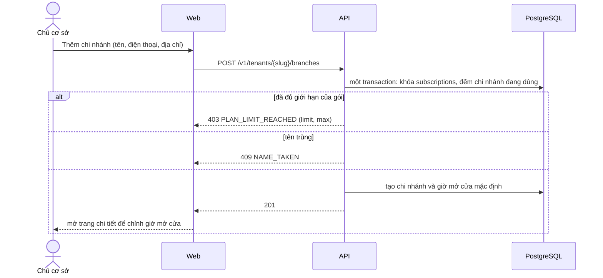
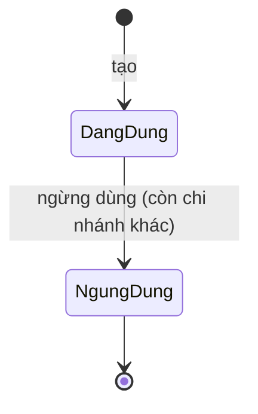
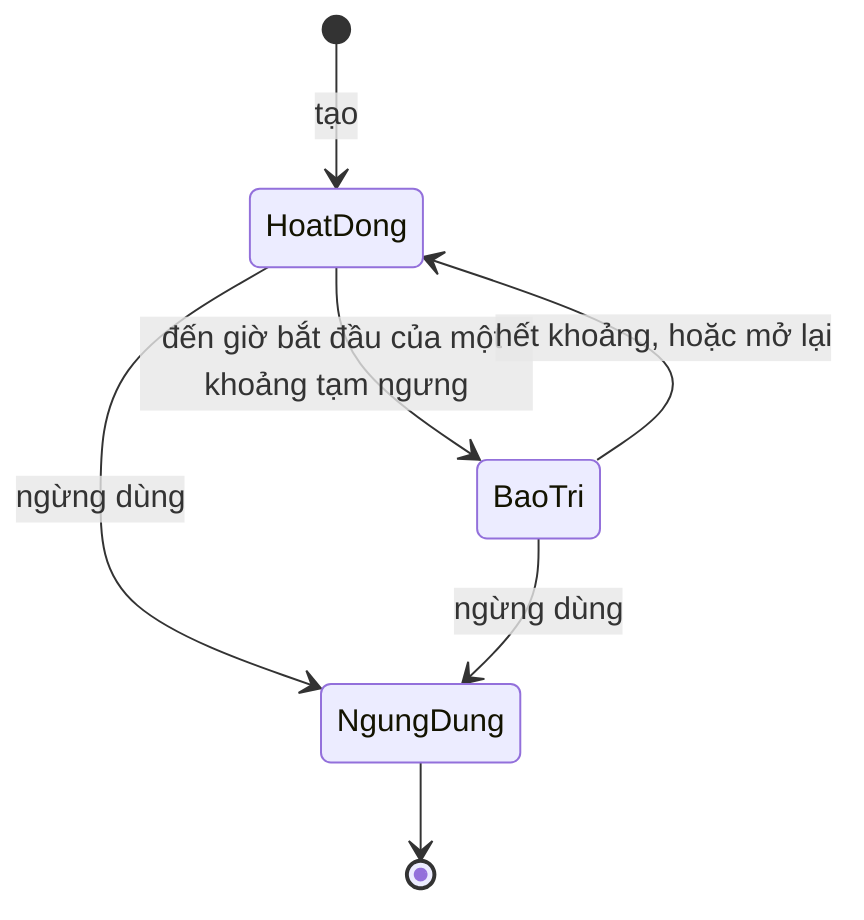

## Phạm vi

| Có trong tính năng này | Ở tính năng khác |
|---|---|
| Danh sách, thêm, sửa, ngừng dùng chi nhánh (MH-42, MH-43) | Nhân viên (tài nguyên `is_staff`), hồ sơ, kỹ năng, ca: Nhân sự (MH-47, MH-48), Xếp ca (MH-38) |
| Giờ mở cửa nhiều khung mỗi ngày, ngày đặc biệt (BR-02) | Giá của dịch vụ, kể cả giá riêng của chi nhánh: Dịch vụ (MH-44, MH-45) |
| Giới hạn số chi nhánh theo gói (BR-83) | Mua, nâng, hạ gói: Gói Sapio (MH-61, BR-84, BR-85) |
| Loại tài nguyên: thêm, đổi tên, xóa (MH-46) | Tên miền, thương hiệu: MH-50 |
| Tài nguyên không phải nhân viên: thêm, đổi tên, đổi thứ tự, tạm ngưng bảo trì, ngừng dùng (MH-46) | Chính sách đặt lịch: MH-49 |
| Guard theo (cơ sở, vai trò) dùng chung cho các tính năng sau ([Quy ước API](../api/index.md#quyền-theo-cơ-sở-và-vai-trò)) | |

## Để sau

| Việc | Vì sao để sau | Làm cùng |
|---|---|---|
| Giá riêng của chi nhánh (BR-02, BR-56) | Giá nằm trên biến thể dịch vụ, nên sửa ở màn Dịch vụ | Dịch vụ (MH-45) |
| Số lịch bị ảnh hưởng và cảnh báo khi đổi giờ, thêm ngày đóng cửa, tạm ngưng, ngừng dùng | Cần lịch hẹn và thuật toán giờ trống | Lõi đặt lịch, giai đoạn 3. Hành vi mô tả ở dưới, đánh dấu **áp dụng khi có lịch hẹn** |
| Nhật ký thao tác | BR-63 không liệt kê các thao tác này | |
| Dùng lại chi nhánh hoặc tài nguyên đã ngừng dùng | Dùng lại kéo theo kiểm lại giới hạn gói và tên trùng | |
| Bước lưới giờ của chi nhánh (`slot_step_minutes`, BR-58) | Chỉ trang đặt lịch đọc nó; mặc định 15 phút | Lõi đặt lịch, giai đoạn 3 |
| Gỡ thành viên và nhân viên khỏi chi nhánh bị ngừng dùng | Bảng gắn chi nhánh nằm ở Nhân sự | Nhân sự (MH-47) |
| Quản lý, lễ tân, kỹ thuật viên đọc chi nhánh và tài nguyên | Nhóm endpoint này giữ chỉ chủ cơ sở (BR-93.1, AC-58); các vai trò đó đọc qua endpoint của tính năng dùng nó | Bộ chọn chi nhánh, Lịch, Xếp ca |

## Khái niệm

| Tên | Trong code | Nghĩa |
|---|---|---|
| Chi nhánh | `branch` | Một địa điểm của cơ sở. Múi giờ luôn là `Asia/Ho_Chi_Minh` |
| Chi nhánh đang dùng | `branches.archived_at` rỗng | Chỉ chi nhánh đang dùng được tính vào giới hạn của gói |
| Ngừng dùng | `archived_at` có giá trị | Giữ dòng, không xóa cứng; không dùng lại |
| Khung giờ | `opening_hours` | Một khoảng `opens` đến `closes` của một ngày trong tuần. Nhiều khung một ngày là nghỉ trưa, ca sáng ca chiều |
| Ngày đặc biệt | `special_day` | Một ngày theo lịch có giờ riêng, thay giờ thường lệ của ngày đó. Không có khung nào là đóng cửa cả ngày |
| Giới hạn chi nhánh | `plans.limits.branches` | Số chi nhánh đang dùng tối đa; `null` là không giới hạn |
| Loại tài nguyên | `resource_type` | Dịch vụ chiếm theo loại, hệ thống chọn tài nguyên cụ thể (BR-50) |
| Loại nhân viên | `resource_type.is_staff` | Loại có sẵn của cơ sở; không sửa, không xóa |
| Tài nguyên | `resource` | Ghế, giường, phòng, bồn. Thuộc đúng một chi nhánh và một loại |
| Khoảng tạm ngưng | `resource_pause` | Khoảng giờ tài nguyên không dùng được, kèm lý do (BR-37) |

## Quy tắc

### Quyền và gói (BR-93.1 đến BR-93.3)

| Mã | Quy tắc |
|---|---|
| BR-93.1 | Mọi thao tác ở tính năng này chỉ chủ cơ sở (`owner`) làm được. Vai trò khác nhận 403 `FORBIDDEN`; tài khoản không thuộc cơ sở nhận 404 `NOT_FOUND` |
| BR-93.2 | Số chi nhánh đang dùng không vượt `plans.limits.branches` của gói hiện tại; đang dùng thử thì theo gói `pro` (BR-81). Thêm chi nhánh khi đã đủ: 403 `PLAN_LIMIT_REACHED`. Kiểm trong transaction đã khóa dòng `subscriptions` của cơ sở, nên hai yêu cầu cùng lúc không vượt giới hạn |
| BR-93.3 | Gói hết hạn (BR-82) thì mọi thao tác ở đây trả 402 `SUBSCRIPTION_EXPIRED`; cơ sở bị khóa (BR-75) thì trả 403 `TENANT_LOCKED` |

### Chi nhánh (BR-93.4 đến BR-93.10)

| Mã | Quy tắc |
|---|---|
| BR-93.4 | Tên chi nhánh 1 đến 100 ký tự, không trùng tên chi nhánh đang dùng khác của cơ sở (không phân biệt hoa thường, bỏ khoảng trắng thừa). Trùng: 409 `NAME_TAKEN`. Tên của chi nhánh đã ngừng dùng không tính |
| BR-93.5 | Số điện thoại là số Việt Nam bắt đầu bằng `0` hoặc `+84`, tổng 10 hoặc 11 chữ số (di động hoặc điện thoại bàn); chuẩn hóa theo BR-61 và lưu dạng E.164. Địa chỉ 1 đến 255 ký tự |
| BR-93.6 | Múi giờ cố định `Asia/Ho_Chi_Minh`: API không nhận trường `timezone`, giao diện hiện ô múi giờ ở trạng thái khóa |
| BR-93.7 | Chi nhánh mới có giờ mở cửa mặc định 08:00 đến 20:00, Chủ Nhật nghỉ (như BR-74.17), chưa có tài nguyên. Tên, số điện thoại, địa chỉ do chủ cơ sở nhập |
| BR-93.8 | Màn chi tiết lưu **một lần** cả thông tin, giờ mở cửa và ngày đặc biệt trong một transaction; lỗi một phần thì không đổi gì. Thay đổi áp từ lúc lưu (BR-38) |
| BR-93.9 | Ngừng dùng chi nhánh không xóa gì: giờ mở cửa, ngày đặc biệt, tài nguyên giữ nguyên, nhưng tài nguyên của chi nhánh hiện là đã ngừng dùng ở danh sách tài nguyên. Chi nhánh ngừng dùng không sửa được, không nhận tài nguyên mới và không nhận lịch hẹn; không dùng lại |
| BR-93.10 | Không ngừng dùng được chi nhánh đang dùng cuối cùng: 409 `LAST_BRANCH`. **Áp dụng khi có lịch hẹn:** chi nhánh còn lịch hẹn sắp tới thì 409 `BRANCH_HAS_UPCOMING_APPOINTMENTS` |

### Giờ mở cửa và ngày đặc biệt (BR-93.11 đến BR-93.15)

| Mã | Quy tắc |
|---|---|
| BR-93.11 | Mỗi ngày trong tuần có từ 0 đến 4 khung; 0 khung là nghỉ cả ngày. Ít nhất một ngày có khung |
| BR-93.12 | Khung có dạng `HH:mm` theo giờ chi nhánh, từ 00:00 đến 23:59, `opens` trước `closes`. Hai khung cùng ngày không chồng nhau (BR-02); khung nối liền (đóng 12:00, mở 12:00) hợp lệ. Cơ sở dữ liệu giữ ràng buộc này bằng exclusion constraint, không chỉ ứng dụng |
| BR-93.13 | Ngày đặc biệt là một ngày theo lịch từ hôm nay trở đi (giờ chi nhánh), thay hoàn toàn giờ thường lệ của ngày đó (BR-02). Không khung nào là đóng cửa cả ngày; có khung thì theo BR-93.12, tối đa 4. Ghi chú 0 đến 200 ký tự. Mỗi ngày một dòng; các ngày trong một lần lưu không trùng nhau |
| BR-93.14 | Ngày đặc biệt đã qua không hiện ở màn hình và không bị lần lưu nào đổi hay xóa |
| BR-93.15 | **Áp dụng khi có lịch hẹn:** lưu giờ mở cửa hoặc ngày đặc biệt làm lịch hẹn sắp tới nằm ngoài giờ mới thì lịch vẫn giữ giá và vào "Cần xếp lại" (BR-02, BR-35, BR-38). Giao diện báo số lịch đó trước khi lưu |

### Loại tài nguyên (BR-93.16 đến BR-93.19)

| Mã | Quy tắc |
|---|---|
| BR-93.16 | Cơ sở mới có bốn loại (BR-74.18). Loại nhân viên không sửa, không xóa, và không có loại nhân viên thứ hai: loại thêm ở đây luôn không phải nhân viên. Thao tác vào loại nhân viên: 409 `RESOURCE_TYPE_PROTECTED` |
| BR-93.17 | Thêm loại: tên 1 đến 50 ký tự, không trùng tên loại nào của cơ sở (không phân biệt hoa thường): 409 `NAME_TAKEN` |
| BR-93.18 | Đổi tên loại không phải nhân viên. Dịch vụ và tài nguyên tham chiếu theo id nên không đổi |
| BR-93.19 | Xóa loại không phải nhân viên khi không còn tài nguyên nào thuộc loại đó (kể cả đã ngừng dùng) và không đoạn hay dòng dọn dẹp nào của biến thể nào chiếm loại đó, kể cả biến thể đã xóa hay dịch vụ đã ngừng dùng (BR-50, BR-52, [BR-94.32](./services.md)). Còn thì 409 `RESOURCE_TYPE_IN_USE`. Xóa là xóa dòng |

### Tài nguyên (BR-93.20 đến BR-93.27)

| Mã | Quy tắc |
|---|---|
| BR-93.20 | Màn Tài nguyên chỉ quản lý tài nguyên không phải nhân viên. Tài nguyên nhân viên tạo và sửa ở Nhân sự |
| BR-93.21 | Thêm tài nguyên: tên 1 đến 50 ký tự, một chi nhánh đang dùng, một loại không phải nhân viên. Tên không trùng tên tài nguyên đang dùng khác cùng chi nhánh (không phân biệt hoa thường): 409 `NAME_TAKEN`. Tài nguyên mới xếp cuối nhóm (chi nhánh, loại) |
| BR-93.22 | Sau khi tạo chỉ đổi được tên. Chi nhánh và loại không đổi, vì dịch vụ chiếm theo loại và lịch hẹn gắn chi nhánh |
| BR-93.23 | Thứ tự là thứ tự trong nhóm (chi nhánh, loại); BR-57 chọn tài nguyên theo thứ tự này ("Ghế 1" trước "Ghế 2"). Đổi thứ tự gửi cả nhóm một lần |
| BR-93.24 | Tạm ngưng bảo trì: khoảng giờ `starts_at` đến `ends_at` kèm lý do 1 đến 200 ký tự. `ends_at` sau `starts_at` và sau `Clock.now()`. `starts_at` trước `Clock.now()` thì lưu bằng `Clock.now()`. Khoảng không chồng khoảng khác của cùng tài nguyên (409 `PAUSE_OVERLAP`); nối liền được. Trong khoảng đó tài nguyên bị trừ khỏi thời gian khả dụng |
| BR-93.25 | Mở lại: khoảng đang diễn ra thì kết thúc ngay lúc bấm; chưa bắt đầu thì xóa; đã kết thúc: 409 `PAUSE_ENDED` |
| BR-93.26 | **Áp dụng khi có lịch hẹn:** lịch dùng tài nguyên trong khoảng tạm ngưng thì chuyển sang tài nguyên cùng loại còn trống, không báo khách; không còn thì vào "Cần xếp lại" (BR-37, BR-35). Giao diện báo trước từng lịch sẽ đi đâu |
| BR-93.27 | Ngừng dùng tài nguyên không xóa dòng; tài nguyên không nhận lịch mới và không dùng lại. Tài nguyên đã ngừng dùng không đổi tên, không tạm ngưng: 409 `RESOURCE_ARCHIVED`. **Áp dụng khi có lịch hẹn:** lịch sắp tới dùng nó xử lý như BR-93.26 |

## Luồng

Chi nhánh có hai trạng thái, đang dùng và ngừng dùng. Tài nguyên có ba: hoạt động, bảo trì và ngừng dùng. Hoạt động và bảo trì không lưu thành cột; chúng suy ra từ khoảng tạm ngưng và giờ hiện tại.

## Tiêu chí chấp nhận

Mỗi dòng là ít nhất một test. Tên test bắt đầu bằng mã quy tắc, như ở [Đăng ký cơ sở](./signup.md#tiêu-chí-chấp-nhận). Đồng hồ giả dùng `Clock`. Số thứ tự tiếp từ AC-56. Dữ liệu mẫu: `toc-may` (gói `pro`, chủ `chinh@tocmay.vn`, một chi nhánh) và `la-sen` (gói `basic`, chủ `ha.le@lasen.vn`, một chi nhánh).

### Quyền và gói

| # | Cho | Khi | Thì | Quy tắc |
|---|---|---|---|---|
| AC-57 | Chủ `toc-may` | Gọi từng endpoint của nhóm này với dữ liệu hợp lệ | Mỗi endpoint trả mã thành công của nó | BR-93.1 |
| AC-58 | Phiên của quản lý, lễ tân, kỹ thuật viên của `toc-may` | Gọi từng endpoint của nhóm này | 403 `FORBIDDEN`; không có dữ liệu nào đổi | BR-93.1 |
| AC-59 | Tài khoản chỉ thuộc `la-sen`; tài khoản chưa đăng nhập; tài khoản chưa xác thực email | Gọi `GET /v1/tenants/toc-may/branches` | 404 `NOT_FOUND` (giống với slug `khong-co`); 401 `UNAUTHENTICATED`; 403 `EMAIL_NOT_VERIFIED` | BR-93.1 |
| AC-60 | Chủ `toc-may` | Đọc, sửa, ngừng dùng chi nhánh, tài nguyên, loại, khoảng tạm ngưng bằng id của `la-sen`; liệt kê chi nhánh và tài nguyên | 404 `NOT_FOUND` cho từng id; danh sách chỉ có dòng của `toc-may` | BR-93.1 |
| AC-61 | Gói `toc-may` hết hạn theo `Clock` giả (quá `current_period_end`); rồi cơ sở bị khóa | Gọi một endpoint của nhóm này | 402 `SUBSCRIPTION_EXPIRED`; sau khi khóa: 403 `TENANT_LOCKED`; dữ liệu không đổi | BR-93.3 |
| AC-62 | `la-sen`, gói `basic`, một chi nhánh đang dùng | Thêm chi nhánh | 403 `PLAN_LIMIT_REACHED` với `limit = branches`, `max = 1`; số chi nhánh không đổi | BR-93.2 |
| AC-63 | `toc-may` đang dùng thử (gói `pro`, `trial_ends_at` còn) | Thêm hai chi nhánh liên tiếp | Cả hai 201 | BR-93.2 |
| AC-64 | Gói có `limits.branches = 2`, cơ sở đang dùng 1 chi nhánh | Hai yêu cầu thêm chi nhánh (tên khác nhau) chạy cùng lúc | Đúng một 201, yêu cầu kia 403 `PLAN_LIMIT_REACHED`; có đúng 2 chi nhánh đang dùng | BR-93.2 |
| AC-65 | Gói có `limits.branches = 2`, cơ sở đang dùng 2 chi nhánh | Thêm chi nhánh: 403. Ngừng dùng một chi nhánh, rồi thêm lại | Lần đầu 403; sau khi ngừng dùng, 201 | BR-93.2, BR-93.9 |

### Chi nhánh

| # | Cho | Khi | Thì | Quy tắc |
|---|---|---|---|---|
| AC-66 | Chủ `toc-may` | `GET` danh sách chi nhánh | 200; mặc định chỉ chi nhánh đang dùng; `status=archived` chỉ chi nhánh ngừng dùng, `status=all` cả hai; có `plan.name`, `plan.maxBranches`, `plan.activeBranches` | BR-93.2, BR-93.9 |
| AC-67 | Chủ `toc-may` | Thêm chi nhánh "Quận 7", số `028 3930 1234`, địa chỉ hợp lệ | 201; số lưu `+842839301234`; `timezone = Asia/Ho_Chi_Minh`; giờ mở cửa 08:00 đến 20:00 Thứ Hai đến Thứ Bảy, Chủ Nhật không có khung; không có tài nguyên | BR-93.5, BR-93.6, BR-93.7 |
| AC-68 | Chủ `toc-may` | Thêm chi nhánh với tên rỗng / tên 101 ký tự / địa chỉ rỗng / số `123` / có trường `timezone` | 400 `VALIDATION_FAILED`, `errors` chỉ đúng trường (`name`, `name`, `address`, `phone`, `timezone`); không tạo gì | BR-93.4, BR-93.5, BR-93.6 |
| AC-69 | Đã có "Tóc Mây Quận 3" | Thêm chi nhánh tên " tóc mây  quận 3 "; thêm chi nhánh trùng tên một chi nhánh đã ngừng dùng | 409 `NAME_TAKEN`; 201 | BR-93.4 |
| AC-70 | Gói không giới hạn chi nhánh | Hai yêu cầu thêm chi nhánh cùng tên chạy cùng lúc | Đúng một 201, yêu cầu kia 409 `NAME_TAKEN` (không phải 500) | BR-93.4 |
| AC-71 | Chi nhánh `toc-may` có giờ thường lệ và ngày đặc biệt 2026-12-25, 2026-11-01 (đã qua) | `GET` chi tiết | 200; `openingHours` đủ khung; `specialDays` chỉ có ngày từ hôm nay (giờ chi nhánh) trở đi | BR-93.14 |
| AC-72 | Chủ `toc-may` | Sửa chi nhánh: đổi tên, số điện thoại, địa chỉ, giờ Thứ Hai thành 09:00–12:00 và 14:00–20:00, thêm ngày đặc biệt 2026-12-25 đóng cửa | 200; đọc lại thấy đúng; `branches.updated_at` đổi | BR-93.8, BR-93.11, BR-93.13 |
| AC-73 | Chủ `toc-may` | Sửa chi nhánh với: không ngày nào mở / 5 khung một ngày / `closes` bằng `opens` / `closes` là `24:00` / khung 09:00–12:00 và 11:00–15:00 | Mỗi ca 400 `VALIDATION_FAILED`; ca chồng nhau báo ở `openingHours.{i}.opens` của khung sau; không đổi gì | BR-93.11, BR-93.12 |
| AC-74 | Chủ `toc-may` | Sửa chi nhánh với khung 09:00–12:00 và 12:00–20:00 | 200 | BR-93.12 |
| AC-75 | Chạy bằng role `app_user` | Ghi thẳng hai dòng `opening_hours` chồng nhau cùng chi nhánh, cùng ngày | Vi phạm exclusion constraint; dòng thứ hai không vào | BR-93.12 |
| AC-76 | Chủ `toc-may` | Sửa chi nhánh với ngày đặc biệt: quá khứ / trùng ngày trong một lần gửi / ghi chú 201 ký tự / 5 khung | Mỗi ca 400 `VALIDATION_FAILED`, `errors` chỉ `specialDays.{i}.date`, `specialDays.{i}.date`, `specialDays.{i}.note`, `specialDays.{i}.windows`; không đổi gì | BR-93.13 |
| AC-77 | Chi nhánh có ngày đặc biệt A (tương lai) và B (đã qua) | Sửa chi nhánh với danh sách ngày đặc biệt chỉ có C | A bị xóa, C được thêm, B còn nguyên | BR-93.13, BR-93.14 |
| AC-78 | Một lần sửa có thông tin hợp lệ nhưng giờ mở cửa sai | Sửa chi nhánh | 400; tên và địa chỉ trong yêu cầu cũng không được lưu | BR-93.8 |
| AC-79 | Chi nhánh đã ngừng dùng | Sửa chi nhánh; thêm tài nguyên vào đó; ngừng dùng lần nữa | Cả ba 409 `BRANCH_ARCHIVED` | BR-93.9 |
| AC-80 | `toc-may` có hai chi nhánh đang dùng, chi nhánh B có hai tài nguyên | Ngừng dùng B | 200; `archivedAt` có giá trị; B vẫn có ở `status=all`; hai tài nguyên và giờ mở cửa của B còn nguyên; `GET` tài nguyên với `status=archived` có hai tài nguyên đó | BR-93.9 |
| AC-81 | `toc-may` có đúng một chi nhánh đang dùng | Ngừng dùng chi nhánh đó | 409 `LAST_BRANCH`; không đổi gì | BR-93.10 |
| AC-82 | `toc-may` có hai chi nhánh đang dùng | Hai yêu cầu ngừng dùng, mỗi yêu cầu một chi nhánh, chạy cùng lúc | Đúng một yêu cầu 200, yêu cầu kia 409 `LAST_BRANCH`; còn đúng một chi nhánh đang dùng | BR-93.10 |
| AC-83 | **Áp dụng khi có lịch hẹn.** Chi nhánh có lịch xác nhận sau hôm nay | Ngừng dùng | 409 `BRANCH_HAS_UPCOMING_APPOINTMENTS`, kèm số lịch | BR-93.10 |
| AC-84 | **Áp dụng khi có lịch hẹn.** Chi nhánh có lịch 18:30 ngày D, giờ mới của ngày D đóng 18:00 | Sửa giờ mở cửa | 200; lịch vào "Cần xếp lại", giữ giá; phản hồi có số lịch bị ảnh hưởng | BR-93.15 |

### Loại tài nguyên

| # | Cho | Khi | Thì | Quy tắc |
|---|---|---|---|---|
| AC-85 | `toc-may` | `GET` loại tài nguyên | 200; ba loại "Thợ" (`isStaff`), "Ghế cắt", "Giường gội" kèm `resourceCount` (đang dùng) | BR-93.16 |
| AC-86 | Chủ `toc-may` | Thêm loại "Bồn ngâm"; thêm "ghế cắt"; thêm loại với `isStaff: true` | 201 với `isStaff = false`; 409 `NAME_TAKEN`; 400 `VALIDATION_FAILED` ở trường `isStaff` | BR-93.16, BR-93.17 |
| AC-87 | Chủ `toc-may` | Đổi tên "Ghế cắt" thành "Ghế"; đổi tên loại nhân viên | 200; 409 `RESOURCE_TYPE_PROTECTED` | BR-93.16, BR-93.18 |
| AC-88 | Loại X có một tài nguyên đã ngừng dùng; loại Y không có tài nguyên | Xóa X; xóa Y; xóa loại nhân viên | 409 `RESOURCE_TYPE_IN_USE`; 204 và dòng Y mất; 409 `RESOURCE_TYPE_PROTECTED` | BR-93.16, BR-93.19 |
| AC-89 | Một dịch vụ có đoạn chiếm loại Z, Z không có tài nguyên (test cùng [AC-155](./services.md#loại-tài-nguyên)) | Xóa Z | 409 `RESOURCE_TYPE_IN_USE` | BR-93.19 |

### Tài nguyên

| # | Cho | Khi | Thì | Quy tắc |
|---|---|---|---|---|
| AC-90 | Chủ `toc-may`, nhóm (Quận 3, Ghế cắt) có Ghế 1 đến Ghế 3 | Thêm "Ghế 4" vào nhóm đó | 201; `sort` lớn hơn của Ghế 3 | BR-93.21 |
| AC-91 | Chủ `toc-may` | Thêm tài nguyên với loại nhân viên / loại của `la-sen` / chi nhánh đã ngừng dùng / tên rỗng hoặc 51 ký tự | 400 `VALIDATION_FAILED` ở `resourceTypeId`; 404 `NOT_FOUND`; 409 `BRANCH_ARCHIVED`; 400 ở `name` | BR-93.20, BR-93.21 |
| AC-92 | Đã có "Ghế 1" ở Quận 3 (đang dùng), "Ghế 2" đã ngừng dùng | Thêm " ghế 1 " cùng chi nhánh; thêm "Ghế 1" ở chi nhánh khác; thêm "Ghế 2" cùng chi nhánh | 409 `NAME_TAKEN`; 201; 201 | BR-93.21 |
| AC-93 | Gói không giới hạn | Hai yêu cầu thêm cùng tên, cùng chi nhánh, chạy cùng lúc | Đúng một 201, yêu cầu kia 409 `NAME_TAKEN` | BR-93.21 |
| AC-94 | Một tài nguyên | Đổi tên; gửi kèm `resourceTypeId` hoặc `branchId` | 200; 400 `VALIDATION_FAILED` ở trường thừa | BR-93.22 |
| AC-95 | Nhóm có Ghế 1, Ghế 2, Ghế 3 | Gửi thứ tự mới (Ghế 3, Ghế 1, Ghế 2); gửi thiếu một id; gửi thêm id của nhóm khác | 200 và `GET` trả đúng thứ tự mới; hai ca sau 409 `ORDER_MISMATCH`, thứ tự không đổi | BR-93.23 |
| AC-96 | Một tài nguyên đang hoạt động | Tạm ngưng từ 2026-12-01 08:00 đến 2026-12-01 12:00, lý do "Sửa ghế" | 201; `GET` tài nguyên có khoảng đó | BR-93.24 |
| AC-97 | Giờ hiện tại 2026-11-28 10:00 | Tạm ngưng với `endsAt` bằng `startsAt` / `endsAt` trước 10:00 / lý do rỗng / lý do 201 ký tự; rồi với `startsAt` 08:00 cùng ngày, `endsAt` 12:00 | Bốn ca đầu 400 `VALIDATION_FAILED` ở `endsAt` hoặc `reason`, không đổi gì; ca cuối 201, `startsAt` lưu và trả về là 10:00 | BR-93.24 |
| AC-98 | Đã có khoảng 08:00–12:00 ngày D | Tạm ngưng 11:00–14:00; tạm ngưng 12:00–14:00; hai yêu cầu chồng nhau chạy cùng lúc | 409 `PAUSE_OVERLAP`; 201; đúng một yêu cầu 201, yêu cầu kia 409 `PAUSE_OVERLAP` | BR-93.24 |
| AC-99 | Ba khoảng: đang diễn ra, chưa bắt đầu, đã kết thúc | Mở lại từng khoảng | Khoảng đang diễn ra: 204, `endsAt` bằng lúc bấm; chưa bắt đầu: 204, dòng mất; đã kết thúc: 409 `PAUSE_ENDED` | BR-93.25 |
| AC-100 | **Áp dụng khi có lịch hẹn.** Ngày D chỉ có Ghế 1 đến Ghế 3; Ghế 2 có lịch A 10:00–11:00, Ghế 3 có lịch B 10:30–11:30, Ghế 1 trống cả buổi | Tạm ngưng Ghế 2 cả ngày D, rồi tạm ngưng Ghế 3 cả ngày D | Sau lần đầu A chuyển sang Ghế 1, khách không nhận email; sau lần hai B không còn ghế (Ghế 1 bận bởi A) nên vào "Cần xếp lại" | BR-93.26 |
| AC-101 | Một tài nguyên đang hoạt động | Ngừng dùng; ngừng dùng lần nữa; đổi tên; tạm ngưng | 200 và dòng còn trong DB với `archivedAt`; ba lần sau 409 `RESOURCE_ARCHIVED` | BR-93.27 |
| AC-102 | Chủ `toc-may` | Gửi hơn 60 yêu cầu ghi trong một phút, hoặc hơn 300 yêu cầu đọc | Yêu cầu vượt hạn nhận 429 `RATE_LIMITED` kèm `Retry-After` | [giới hạn theo phiên](../api/branch-settings.md#giới-hạn-theo-phiên) |

## Liên quan

- Màn hình: [Chi nhánh và tài nguyên](../screens/branch-settings.md) (MH-42, MH-43, MH-46), [Danh sách màn hình](../screens/index.md)
- API: [Chi nhánh và tài nguyên](../api/branch-settings.md), [Quy ước API](../api/index.md#quyền-theo-cơ-sở-và-vai-trò)
- Bảng: `branches`, `opening_hours`, `special_days`, `special_day_hours`, `resource_types`, `resources`, `resource_pauses`, `plans`, `subscriptions` trong [ERD](../architecture/erd.md)
- Quyết định: [T-07](../decisions/t07-row-level-security.md), [T-17](../decisions/t17-plan-entitlements.md), [D-16](../decisions/d16-beauty-only-scope.md)
