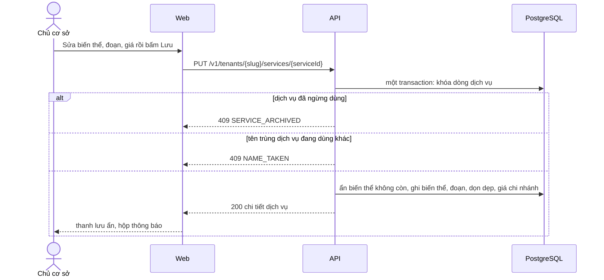
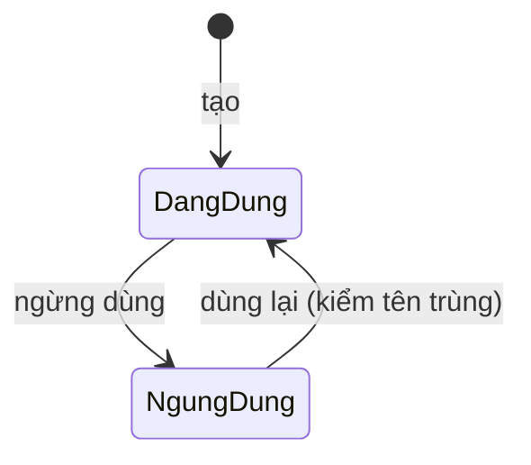

## Phạm vi

| Có trong tính năng này | Ở tính năng khác |
|---|---|
| Danh sách, thêm, sửa, ngừng dùng, dùng lại dịch vụ (MH-44, MH-45) | Giá theo cấp nhân viên (BR-56): Nhân sự (MH-47, MH-48) |
| Nhóm dịch vụ: thêm, đổi tên, xóa, đổi thứ tự (MH-44) | "Ai làm được" (BR-03, `staff_skills`): Nhân sự (MH-47, MH-48) |
| Biến thể: 1 đến 10 mỗi dịch vụ, tên, giá gốc, thứ tự, xóa (BR-13, BR-55) | Đặt cọc khi đặt online (BR-29): giai đoạn 4 |
| Đoạn Chuẩn bị, Làm, Chờ và loại tài nguyên mỗi đoạn chiếm (BR-50, BR-51) | Loại tài nguyên và tài nguyên: [Chi nhánh và tài nguyên](./branch-settings.md) |
| Dọn dẹp theo loại tài nguyên (BR-52) | Lễ tân và khách đọc dịch vụ: API đặt lịch, giai đoạn 3 |
| Giá riêng của từng chi nhánh (BR-02) | Tính giờ trống từ các đoạn: [Thuật toán giờ trống](../architecture/availability-algorithm.md) |
| Nhận đặt online bật hoặc tắt (BR-14) | |
| Guard theo (cơ sở, vai trò) dùng chung ([Quy ước API](../api/index.md#quyền-theo-cơ-sở-và-vai-trò)) | |

## Để sau

| Việc | Vì sao để sau | Làm cùng |
|---|---|---|
| Giá theo cấp nhân viên (BR-56) | Cần cấp nhân viên (`staff_levels`) và hồ sơ nhân viên; dòng `service_prices` có `level` làm ở đó. Bước này chỉ ghi dòng có `level` rỗng | Nhân sự (MH-47, MH-48) |
| "Ai làm được" (BR-03) | Bảng `staff_skills` gắn với hồ sơ nhân viên | Nhân sự (MH-47, MH-48) |
| Đặt cọc khi đặt online (BR-29) | Cột `services.deposit_vnd` có sẵn; API chưa nhận và chưa trả trường này | Giai đoạn 4 |
| Nhật ký đổi giá (BR-63) | Chưa có bảng `audit_logs` và màn Nhật ký | Nhật ký thao tác (MH-57), giai đoạn 3 |
| Số lịch sắp tới dùng dịch vụ, lịch đã đặt giữ nguyên khi sửa hay ngừng dùng (BR-12, BR-59) | Cần lịch hẹn. Hành vi mô tả ở dưới, đánh dấu **áp dụng khi có lịch hẹn** | Lõi đặt lịch, giai đoạn 3 |
| Lễ tân, khách, chatbot đọc dịch vụ | Qua endpoint của tính năng dùng nó; nhóm endpoint này giữ chỉ chủ cơ sở (BR-94.1) | API đặt lịch, giai đoạn 3 |

## Khái niệm

| Tên | Trong code | Nghĩa |
|---|---|---|
| Nhóm dịch vụ | `service_group` | Tiêu đề gom dịch vụ ở trang khách và ở danh sách: Cắt, Nhuộm và uốn |
| Dịch vụ | `service` | Thứ khách đặt. Có một đến mười biến thể |
| Dịch vụ đang dùng | `services.archived_at` rỗng | Chỉ dịch vụ đang dùng hiện ở trang khách và lễ tân chọn được |
| Ngừng dùng | `archived_at` có giá trị | Giữ dòng, không xóa cứng; dùng lại được |
| Biến thể | `service_variant` | Cùng dịch vụ nhưng khác thời lượng, giá. Khách tự chọn (BR-13) |
| Tên trên lịch | `service_variants.short_name` | Nhãn ngắn của biến thể trên lịch lễ tân: "Nhuộm ngắn" |
| Giá gốc | `service_variants.price_vnd` | Giá của biến thể khi chi nhánh không đặt giá riêng |
| Giá riêng chi nhánh | `service_prices` với `level` rỗng | Giá của biến thể ở một chi nhánh (BR-02) |
| Đoạn | `service_segment` | Một khoảng liên tiếp của biến thể, loại `prep`, `work` hoặc `wait`, kèm các loại tài nguyên bị chiếm (BR-50) |
| Phần khách thấy | | Từ đầu đoạn Làm đầu tiên đến cuối đoạn Làm cuối cùng (BR-51) |
| Dọn dẹp | `variant_cleanups` | Số phút một loại tài nguyên còn bận sau đoạn cuối dùng nó (BR-52) |

## Quy tắc

### Quyền và gói (BR-94.1, BR-94.2)

| Mã | Quy tắc |
|---|---|
| BR-94.1 | Mọi thao tác ở tính năng này chỉ chủ cơ sở (`owner`) làm được. Vai trò khác nhận 403 `FORBIDDEN`; tài khoản không thuộc cơ sở nhận 404 `NOT_FOUND`. Lễ tân, kỹ thuật viên và khách đọc dịch vụ qua endpoint của tính năng dùng nó, không qua nhóm này |
| BR-94.2 | Gói hết hạn (BR-82) thì mọi thao tác ở đây trả 402 `SUBSCRIPTION_EXPIRED`; cơ sở bị khóa (BR-75) thì trả 403 `TENANT_LOCKED`. Gói Cơ bản, Chuyên nghiệp và dùng thử đều cấu hình được dịch vụ (BR-81); số dịch vụ, nhóm, biến thể không bị giới hạn theo gói |

### Nhóm dịch vụ (BR-94.3 đến BR-94.7)

| Mã | Quy tắc |
|---|---|
| BR-94.3 | Tên nhóm 1 đến 60 ký tự, bỏ khoảng trắng hai đầu và gộp khoảng trắng thừa ở giữa; không trùng tên nhóm khác của cơ sở (không phân biệt hoa thường): 409 `NAME_TAKEN`. Nhóm mới xếp cuối |
| BR-94.4 | Đổi tên nhóm theo BR-94.3. Dịch vụ tham chiếu nhóm theo id nên không đổi. Giữ nguyên tên và chỉ đổi hoa thường không phải trùng |
| BR-94.5 | Thứ tự nhóm là thứ tự hiện ở danh sách và ở trang khách. Đổi thứ tự gửi cả danh sách một lần; thiếu, thừa hoặc trùng id: 409 `ORDER_MISMATCH` |
| BR-94.6 | Chỉ xóa được nhóm không còn dịch vụ đang dùng: còn thì 409 `SERVICE_GROUP_IN_USE` kèm số dịch vụ. Dịch vụ đã ngừng dùng của nhóm bị xóa thành không nhóm. Xóa là xóa dòng. Xóa và gán dịch vụ vào nhóm chạy cùng lúc không làm mất dịch vụ đang dùng khỏi nhóm |
| BR-94.7 | Dịch vụ không nhóm hiện ở cuối danh sách, dưới tên "Khác". "Khác" không phải một nhóm: không sửa, không xóa, không đổi thứ tự. Tên "Khác" bị giữ chỗ, nên không đặt được cho một nhóm thật (409 `NAME_TAKEN`) |

### Dịch vụ (BR-94.8 đến BR-94.16)

| Mã | Quy tắc |
|---|---|
| BR-94.8 | Tên dịch vụ 1 đến 80 ký tự, chuẩn hóa như BR-94.3; không trùng tên dịch vụ đang dùng khác của cơ sở (không phân biệt hoa thường): 409 `NAME_TAKEN`. Tên dịch vụ đã ngừng dùng không tính. Mô tả cho khách 0 đến 500 ký tự. Nhóm là một nhóm của cơ sở hoặc rỗng |
| BR-94.9 | Thêm dịch vụ bằng hộp nhỏ gồm tên, nhóm và một biến thể đầu: tên biến thể, giá, số phút của một đoạn Làm chiếm loại nhân viên. Hệ thống tạo biến thể đó với một đoạn Làm tên "Làm" chiếm loại nhân viên, không dọn dẹp, "Tên trên lịch" bằng tên dịch vụ cắt còn 20 ký tự, không giá chi nhánh. Dịch vụ mới chưa nhận đặt online (BR-94.10) và xếp cuối nhóm. Tạo xong mở trang chi tiết để chỉnh tiếp |
| BR-94.10 | Nhận đặt online bật hoặc tắt ngay ở danh sách, và ở trang chi tiết. Tắt thì dịch vụ không hiện ở trang khách và chatbot; lễ tân vẫn chọn được (BR-30). Dịch vụ mới tạo ở trạng thái tắt, vì chưa có ai được xếp làm (BR-03) |
| BR-94.11 | Thứ tự dịch vụ tính trong nhóm (hoặc trong nhóm "Khác"), là thứ tự hiện ở danh sách và trang khách. Đổi thứ tự gửi cả nhóm một lần; `ids` phải đúng bằng tập dịch vụ đang dùng của nhóm: 409 `ORDER_MISMATCH`. Đổi nhóm của một dịch vụ thì dịch vụ xếp cuối nhóm mới |
| BR-94.12 | Ngừng dùng đặt `archived_at`, không xóa gì: biến thể, đoạn, dọn dẹp, giá chi nhánh giữ nguyên. Dịch vụ không hiện ở trang khách, lễ tân không chọn được. Không có thao tác xóa hẳn dịch vụ. **Áp dụng khi có lịch hẹn:** lịch đã đặt giữ nguyên và vẫn hiện ở lịch |
| BR-94.13 | Dùng lại bỏ `archived_at` và kiểm tên như BR-94.8: trùng một dịch vụ đang dùng thì 409 `NAME_TAKEN`. Dịch vụ xếp cuối nhóm của nó; "Nhận đặt online" giữ giá trị trước khi ngừng dùng. Dùng lại dịch vụ đang dùng: 409 `SERVICE_NOT_ARCHIVED` |
| BR-94.14 | Dịch vụ đã ngừng dùng chỉ đọc: sửa, đổi "Nhận đặt online" hoặc ngừng dùng lần nữa trả 409 `SERVICE_ARCHIVED`. Muốn sửa thì dùng lại trước |
| BR-94.15 | Danh sách lọc theo nhóm (kể cả "Khác"), theo trạng thái (đang dùng, đã ngừng dùng, tất cả; mặc định đang dùng) và theo tên (chứa chuỗi, không phân biệt hoa thường và dấu). Sắp theo thứ tự nhóm, rồi thứ tự dịch vụ; dịch vụ không nhóm ở cuối |
| BR-94.16 | Trang chi tiết lưu **một lần** cả thông tin chung, "Nhận đặt online", các biến thể, đoạn, dọn dẹp và giá chi nhánh trong một transaction; lỗi một phần thì không đổi gì. Biến thể đã có giữ id, biến thể mới nhận id mới. Hai lần lưu cùng một dịch vụ chạy cùng lúc xếp hàng theo khóa dòng dịch vụ. Không có kiểm phiên bản: lần lưu sau ghi đè lần trước |

### Biến thể (BR-94.17 đến BR-94.21)

| Mã | Quy tắc |
|---|---|
| BR-94.17 | Mỗi dịch vụ có từ 1 đến 10 biến thể đang dùng (BR-55). Lưu với 0 biến thể, tức xóa biến thể cuối cùng, hoặc với 11 biến thể: 400 `VALIDATION_FAILED` ở `variants` |
| BR-94.18 | Tên biến thể 1 đến 40 ký tự, chuẩn hóa như BR-94.3, không trùng biến thể đang dùng khác của cùng dịch vụ (không phân biệt hoa thường). "Tên trên lịch" 1 đến 20 ký tự, được trùng. Tên của biến thể đã xóa dùng lại được |
| BR-94.19 | Giá gốc là số nguyên VND từ 0 đến 100.000.000, là bội của 1.000 (quy tắc 1). Giá 0 hợp lệ |
| BR-94.20 | Thứ tự biến thể là thứ tự trong danh sách gửi lên; trang khách và danh sách đều theo thứ tự đó |
| BR-94.21 | Xóa biến thể là ẩn: đặt `archived_at`, giữ đoạn, dọn dẹp và giá để lịch hẹn sau này còn trỏ tới được. Biến thể ẩn không hiện ở dịch vụ, ở trang khách, và không khôi phục. Biến thể đang dùng không có trong danh sách gửi lên thì bị ẩn |

### Đoạn (BR-94.22 đến BR-94.27)

| Mã | Quy tắc |
|---|---|
| BR-94.22 | Mỗi biến thể có 1 đến 8 đoạn, xếp theo thứ tự gửi lên. Mỗi đoạn có loại, tên 1 đến 40 ký tự (hiện trên lịch) và số phút từ 5 đến 480, là bội của 5 |
| BR-94.23 | Chuẩn bị (`prep`) chỉ ở vị trí đầu, tối đa một đoạn, và đoạn liền sau phải là Làm (BR-50) |
| BR-94.24 | Có ít nhất một đoạn Làm (`work`): đó là lúc khách có mặt (BR-51) |
| BR-94.25 | Chờ (`wait`) chỉ nằm giữa hai đoạn Làm: đoạn liền trước và đoạn liền sau đều là Làm. Hai đoạn Chờ không liền nhau |
| BR-94.26 | Mỗi đoạn chiếm ít nhất một loại tài nguyên của cơ sở, mỗi loại tối đa một lần. Mỗi mục lịch hẹn có một người làm (BR-53), nên mọi đoạn Làm chiếm loại nhân viên. Đoạn Chờ không chiếm loại nhân viên (BR-05), nên phải chiếm ít nhất một loại khác. Đoạn Chuẩn bị chiếm loại nhân viên hay không là tùy |
| BR-94.27 | Phần khách thấy, từ đầu đoạn Làm đầu tiên đến cuối đoạn Làm cuối cùng, kể cả các đoạn Chờ ở giữa, dài tối đa 480 phút. Chuẩn bị và dọn dẹp không tính |

### Dọn dẹp (BR-94.28)

| Mã | Quy tắc |
|---|---|
| BR-94.28 | Dọn dẹp khai theo từng loại tài nguyên **không phải nhân viên** mà ít nhất một đoạn của biến thể chiếm (BR-52): 5 đến 120 phút, là bội của 5. Loại không khai là không dọn. Khai loại nhân viên, loại không có đoạn nào chiếm, hoặc một loại hai lần: 400 `VALIDATION_FAILED` |

### Giá riêng của chi nhánh (BR-94.29)

| Mã | Quy tắc |
|---|---|
| BR-94.29 | Mỗi biến thể có thể đặt giá cho từng chi nhánh **đang dùng**, theo luật giá của BR-94.19; không đặt là dùng giá gốc (BR-02). Mỗi chi nhánh một giá. Chi nhánh đã ngừng dùng: 409 `BRANCH_ARCHIVED`. Giá đã đặt cho chi nhánh sau này ngừng dùng giữ nguyên, không hiện và không bị lần lưu nào đổi. Giá ở một chi nhánh là giá chi nhánh nếu có, không thì giá gốc. Giao diện hiện khối giá chi nhánh khi cơ sở có từ hai chi nhánh đang dùng, hoặc khi biến thể đang sửa đã có giá riêng ở một chi nhánh đang dùng |

### Chi nhánh thiếu tài nguyên (BR-94.30)

| Mã | Quy tắc |
|---|---|
| BR-94.30 | Chi nhánh đang dùng không có tài nguyên đang dùng nào thuộc một loại mà một đoạn của biến thể chiếm thì biến thể không đặt được ở chi nhánh đó. Trang chi tiết cảnh báo từng cặp (chi nhánh, biến thể, loại) và vẫn cho lưu: cơ sở có thể thêm tài nguyên sau |

### Lịch đã đặt (BR-94.31)

| Mã | Quy tắc |
|---|---|
| BR-94.31 | Sửa đoạn, thời lượng, giá, dọn dẹp, xóa biến thể chỉ áp cho lịch đặt sau lúc lưu (BR-38, BR-59). **Áp dụng khi có lịch hẹn:** lịch đã đặt lưu bản sao thời lượng từng đoạn, tài nguyên và giá lúc đặt (BR-12), nên không đổi theo; phản hồi chi tiết dịch vụ có số lịch sắp tới dùng dịch vụ để giao diện báo trước khi lưu |

### Loại tài nguyên đang được dùng (BR-94.32)

| Mã | Quy tắc |
|---|---|
| BR-94.32 | Loại tài nguyên mà một đoạn hoặc một dòng dọn dẹp của biến thể nào chiếm, kể cả biến thể đã xóa hoặc dịch vụ đã ngừng dùng, không xóa được: 409 `RESOURCE_TYPE_IN_USE` (BR-93.19) |

### Đoạn hợp lệ và không hợp lệ

| Dãy đoạn | Hợp lệ | Vì sao |
|---|---|---|
| Làm | Có | |
| Chuẩn bị, Làm | Có | |
| Chuẩn bị, Làm, Chờ, Làm, Làm | Có | Nhuộm tóc |
| Làm, Chờ, Làm | Có | Ngâm bùn, xông hơi |
| Chuẩn bị | Không | Thiếu đoạn Làm (BR-94.24) |
| Chuẩn bị, Chờ, Làm | Không | Sau Chuẩn bị phải là Làm (BR-94.23) |
| Làm, Chuẩn bị | Không | Chuẩn bị chỉ ở vị trí đầu (BR-94.23) |
| Chờ, Làm | Không | Chờ phải nằm giữa hai đoạn Làm (BR-94.25) |
| Làm, Chờ | Không | Chờ phải nằm giữa hai đoạn Làm (BR-94.25) |
| Làm, Chờ, Chờ, Làm | Không | Đoạn Chờ thứ nhất không có Làm ngay sau (BR-94.25) |

## Luồng

Dịch vụ có hai trạng thái, đang dùng và ngừng dùng. Biến thể có hai: đang dùng và đã ẩn, không quay lại.

## Tiêu chí chấp nhận

Mỗi dòng là ít nhất một test. Tên test bắt đầu bằng mã quy tắc, như ở [Đăng ký cơ sở](./signup.md#tiêu-chí-chấp-nhận). Đồng hồ giả dùng `Clock`. Số thứ tự tiếp từ AC-102. Dữ liệu mẫu: `toc-may` (gói `pro`, chủ `chinh@tocmay.vn`; nhóm Cắt, Gội, Nhuộm và uốn; ba dịch vụ Cắt tóc, Gội sấy, Nhuộm tóc; loại Thợ, Ghế cắt, Giường gội) và `la-sen` (gói `basic`, chủ `ha.le@lasen.vn`; bốn nhóm, bốn dịch vụ; loại Kỹ thuật viên, Giường, Bồn ngâm, Phòng xông).

### Quyền và gói

| # | Cho | Khi | Thì | Quy tắc |
|---|---|---|---|---|
| AC-103 | Chủ `toc-may` | Gọi từng endpoint của nhóm này với dữ liệu hợp lệ | Mỗi endpoint trả mã thành công của nó | BR-94.1 |
| AC-104 | Phiên của quản lý, lễ tân, kỹ thuật viên của `toc-may` | Gọi từng endpoint của nhóm này | 403 `FORBIDDEN`; không có dữ liệu nào đổi | BR-94.1 |
| AC-105 | Tài khoản chỉ thuộc `la-sen`; tài khoản chưa đăng nhập; tài khoản chưa xác thực email | Gọi `GET /v1/tenants/toc-may/services` | 404 `NOT_FOUND` (giống với slug `khong-co`); 401 `UNAUTHENTICATED`; 403 `EMAIL_NOT_VERIFIED` | BR-94.1 |
| AC-106 | Chủ `toc-may` | Đọc, sửa, ngừng dùng, đổi thứ tự bằng id nhóm, dịch vụ, biến thể, loại tài nguyên hoặc chi nhánh của `la-sen`; liệt kê nhóm và dịch vụ | 404 `NOT_FOUND` cho từng id; danh sách chỉ có dòng của `toc-may` | BR-94.1 |
| AC-107 | Gói `toc-may` hết hạn theo `Clock` giả; rồi cơ sở bị khóa | Gọi một endpoint của nhóm này | 402 `SUBSCRIPTION_EXPIRED`; sau khi khóa: 403 `TENANT_LOCKED`; dữ liệu không đổi | BR-94.2 |
| AC-108 | `la-sen` (gói `basic`); `toc-may` đang dùng thử | Mỗi cơ sở thêm 30 dịch vụ, 12 nhóm, mỗi dịch vụ 10 biến thể | Mọi yêu cầu 201 hoặc 200; không có `PLAN_LIMIT_REACHED` | BR-94.2 |

### Nhóm dịch vụ

| # | Cho | Khi | Thì | Quy tắc |
|---|---|---|---|---|
| AC-109 | Chủ `toc-may` | `GET` danh sách nhóm | 200; ba nhóm theo `sort`, mỗi nhóm có `serviceCount` (đang dùng) và `archivedServiceCount`; không có dòng "Khác" | BR-94.3, BR-94.5, BR-94.7 |
| AC-110 | Chủ `toc-may` | Thêm nhóm "Phục hồi"; thêm " cắt "; thêm "khác"; thêm tên rỗng / 61 ký tự | 201 và `sort` lớn hơn của mọi nhóm; 409 `NAME_TAKEN`; 409 `NAME_TAKEN`; 400 `VALIDATION_FAILED` ở `name` | BR-94.3, BR-94.7 |
| AC-111 | Chủ `toc-may` | Hai yêu cầu thêm nhóm cùng tên chạy cùng lúc | Đúng một 201, yêu cầu kia 409 `NAME_TAKEN` (không phải 500) | BR-94.3 |
| AC-112 | Nhóm "Gội" và "Cắt" | Đổi "Gội" thành "Gội đầu"; đổi "Cắt" thành "cắt"; đổi "Gội đầu" thành "cắt" | 200; 200; 409 `NAME_TAKEN` | BR-94.4 |
| AC-113 | Ba nhóm A, B, C | Gửi thứ tự (C, A, B); gửi thiếu một id; gửi thêm id của cơ sở khác | 200 và `GET` trả đúng thứ tự mới; hai ca sau 409 `ORDER_MISMATCH`, thứ tự không đổi | BR-94.5 |
| AC-114 | Nhóm "Cắt" có một dịch vụ đang dùng | Xóa nhóm | 409 `SERVICE_GROUP_IN_USE` với `count = 1`; không đổi gì | BR-94.6 |
| AC-115 | Nhóm chỉ còn một dịch vụ đã ngừng dùng | Xóa nhóm | 204; dòng nhóm mất; dịch vụ đó có `groupId = null` | BR-94.6 |
| AC-116 | Dịch vụ X đang dùng, không nhóm; nhóm G không có dịch vụ đang dùng | Một yêu cầu xóa G và một `PUT` chuyển X vào G chạy cùng lúc | Xóa trước thì `PUT` 404 `NOT_FOUND`; `PUT` trước thì xóa 409 `SERVICE_GROUP_IN_USE`; X không bao giờ trỏ tới nhóm đã xóa và không tự mất nhóm | BR-94.6 |
| AC-117 | `toc-may` có dịch vụ không nhóm | `GET` danh sách dịch vụ | Dịch vụ không nhóm ở cuối, `groupId = null`; `groupId=none` chỉ trả các dịch vụ đó | BR-94.7, BR-94.15 |

### Dịch vụ

| # | Cho | Khi | Thì | Quy tắc |
|---|---|---|---|---|
| AC-118 | `toc-may`: Cắt tóc, Gội sấy, Nhuộm tóc đang dùng; "Uốn" đã ngừng dùng | `GET` danh sách mặc định; `status=archived`; `status=all`; `groupId`; `q=nhuom`; `q=NHUỘM` | Chỉ dịch vụ đang dùng; chỉ đã ngừng dùng; cả hai; chỉ nhóm đó; cả hai `q` trả "Nhuộm tóc"; mỗi dòng có `variantCount`, `visibleMinutes`, `priceFromVnd` | BR-94.15 |
| AC-119 | Chủ `toc-may` | Thêm dịch vụ "Uốn tóc", nhóm Nhuộm và uốn, biến thể "Tóc ngắn", giá 600.000, 90 phút | 201 với dạng chi tiết: một biến thể, một đoạn Làm tên "Làm" 90 phút chiếm loại Thợ, `shortName = "Uốn tóc"`, không dọn dẹp, `bookableOnline = false`, `sort` sau mọi dịch vụ của nhóm | BR-94.9, BR-94.10, BR-94.11 |
| AC-120 | Chủ `toc-may` | Thêm dịch vụ với tên rỗng / 81 ký tự; biến thể tên rỗng / 41 ký tự; phút 4 / 7 / 485; giá 150.500 / -1 / 100.001.000 | Mỗi ca 400 `VALIDATION_FAILED`, `errors` chỉ đúng trường (`name`, `variant.name`, `variant.minutes`, `variant.priceVnd`); không tạo gì | BR-94.8, BR-94.9, BR-94.18, BR-94.19, BR-94.22 |
| AC-121 | Đã có "Cắt tóc"; "Cắt tóc cũ" đã ngừng dùng | Thêm " cắt  tóc "; thêm "Cắt tóc cũ"; thêm với `groupId` của `la-sen` | 409 `NAME_TAKEN`; 201; 404 `NOT_FOUND` | BR-94.8 |
| AC-122 | Gói không giới hạn | Hai yêu cầu thêm dịch vụ cùng tên chạy cùng lúc | Đúng một 201, yêu cầu kia 409 `NAME_TAKEN` | BR-94.8 |
| AC-123 | Chủ `toc-may` | Tắt rồi bật "Nhận đặt online" của Cắt tóc; gửi kèm trường khác | 200 và `bookableOnline` đổi theo; 400 `VALIDATION_FAILED` ở trường thừa | BR-94.10 |
| AC-124 | Nhóm có Cắt tóc, Cắt tạo kiểu, Cắt gội | Gửi thứ tự mới; gửi thiếu một id; gửi thêm id của nhóm khác; gửi id dịch vụ đã ngừng dùng của nhóm | 200 và `GET` trả đúng thứ tự mới; ba ca sau 409 `ORDER_MISMATCH`, thứ tự không đổi. `PUT /services/order` không bị route `{serviceId}` bắt | BR-94.11 |
| AC-125 | Dịch vụ X ở nhóm A, nhóm B có hai dịch vụ | Sửa X sang nhóm B; sửa X sang không nhóm | X đứng cuối B; rồi đứng cuối danh sách "Khác" | BR-94.11 |
| AC-126 | Dịch vụ đang dùng có hai biến thể, một giá chi nhánh | Ngừng dùng; ngừng dùng lần nữa | 200 và `archivedAt` có giá trị, biến thể, đoạn, dọn dẹp, giá chi nhánh còn nguyên trong DB; lần sau 409 `SERVICE_ARCHIVED`; dịch vụ mất ở danh sách mặc định, có ở `status=archived` | BR-94.12 |
| AC-127 | Dịch vụ đã ngừng dùng; một dịch vụ đang dùng tên "Gội sấy" | Dùng lại dịch vụ tên "Gội sấy" cũ khi đang có "Gội sấy" khác; dùng lại khi tên không trùng; dùng lại dịch vụ đang dùng | 409 `NAME_TAKEN`; 200, `archivedAt = null`, `bookableOnline` như trước, đứng cuối nhóm; 409 `SERVICE_NOT_ARCHIVED` | BR-94.13 |
| AC-128 | Dịch vụ đã ngừng dùng | `PUT` sửa; `PATCH` đổi "Nhận đặt online" | 409 `SERVICE_ARCHIVED`, không đổi gì | BR-94.14 |
| AC-129 | Chủ `toc-may` | `DELETE /v1/tenants/toc-may/services/{id}` | 404 `NOT_FOUND`; dịch vụ còn nguyên | BR-94.12 |
| AC-130 | Dịch vụ Nhuộm tóc hai biến thể | `PUT` đổi tên, mô tả, giữ biến thể "Tóc ngắn" (có id) đổi giá, bỏ "Tóc dài", thêm "Tóc uốn" (không id) | 200; "Tóc ngắn" giữ id; "Tóc uốn" có id mới; đọc lại thấy đúng, theo thứ tự gửi; `updatedAt` đổi | BR-94.16 |
| AC-131 | Một lần lưu có thông tin chung hợp lệ nhưng một đoạn sai | `PUT` | 400 `VALIDATION_FAILED`; tên và mô tả trong yêu cầu không được lưu; biến thể cũ không đổi | BR-94.16 |
| AC-132 | Hai `PUT` cùng một dịch vụ, cùng tập id biến thể, nội dung khác nhau, chạy cùng lúc; rồi một `PUT` ẩn biến thể V, và một `PUT` đến sau gửi id của V | Chạy các `PUT` | Hai `PUT` đầu cùng 200 theo thứ tự khóa, kết quả đọc lại là của yêu cầu sau; không biến thể nhân đôi, không 500. `PUT` gửi id của V: 404 `NOT_FOUND`, không đổi gì | BR-94.16, BR-94.21 |

### Biến thể

| # | Cho | Khi | Thì | Quy tắc |
|---|---|---|---|---|
| AC-133 | Chủ `toc-may` | `PUT` với `variants` rỗng; với 11 biến thể; với 10 biến thể | 400 `VALIDATION_FAILED` ở `variants`; 400 ở `variants`; 200 | BR-94.17 |
| AC-134 | Chủ `toc-may` | `PUT` với tên biến thể rỗng / 41 ký tự / "Tóc dài" và " tóc  dài " cùng một lần / tên trên lịch rỗng / 21 ký tự | Mỗi ca 400 `VALIDATION_FAILED`, `errors` chỉ `variants.{i}.name` (biến thể sau với ca trùng) hoặc `variants.{i}.shortName`; không đổi gì | BR-94.18 |
| AC-135 | Hai biến thể có cùng "Tên trên lịch" | `PUT` | 200 | BR-94.18 |
| AC-136 | Dịch vụ có biến thể "Tóc dài" | `PUT` bỏ "Tóc dài" và thêm biến thể mới cùng tên "Tóc dài" | 200; biến thể cũ có `archived_at`, biến thể mới đang dùng với id khác | BR-94.18, BR-94.21 |
| AC-137 | Chủ `toc-may` | `PUT` với `priceVnd` 0 / 100.000.000; rồi 100.001.000 / 150.500 / -1.000 / 1.5 / chuỗi | 200 cho hai giá đầu; 400 `VALIDATION_FAILED` ở `variants.{i}.priceVnd` cho các ca sau | BR-94.19 |
| AC-138 | Ba biến thể A, B, C | `PUT` với thứ tự (C, A, B) | `GET` trả C, A, B | BR-94.20 |
| AC-139 | Biến thể đã bị ẩn | `GET` chi tiết; `PUT` gửi lại id của nó | Biến thể không có ở `variants`; 404 `NOT_FOUND`. Dòng biến thể, đoạn, dọn dẹp, giá vẫn còn trong DB | BR-94.21 |

### Đoạn

| # | Cho | Khi | Thì | Quy tắc |
|---|---|---|---|---|
| AC-140 | Chủ `toc-may` | `PUT` biến thể với 0 đoạn / 9 đoạn; tên đoạn rỗng / 41 ký tự; phút 0 / 4 / 7 / 485 | Mỗi ca 400 `VALIDATION_FAILED`, `errors` chỉ đúng trường (`…segments`, `…segments.{j}.label`, `…segments.{j}.minutes`); không đổi gì | BR-94.22 |
| AC-141 | Chủ `toc-may` | `PUT` với Chuẩn bị ở vị trí 2; hai đoạn Chuẩn bị; Chuẩn bị rồi Chờ | Mỗi ca 400 `VALIDATION_FAILED`, `errors` có `…segments.{j}.kind` của đoạn Chuẩn bị vi phạm; không đổi gì | BR-94.23 |
| AC-142 | Chủ `toc-may` | `PUT` biến thể không có đoạn Làm (chỉ Chuẩn bị và Chờ) | 400 ở `…segments` | BR-94.24 |
| AC-143 | Chủ `toc-may` | `PUT` với Chờ ở đầu; Chờ ở cuối; Chờ cạnh Chuẩn bị; hai Chờ liền nhau; Làm, Chờ, Làm | Bốn ca đầu 400 ở `…segments.{j}.kind` của đoạn Chờ; ca cuối 200 | BR-94.25 |
| AC-144 | Chủ `toc-may` | `PUT` với đoạn không có loại nào; đoạn có một loại hai lần; đoạn Làm không có loại Thợ; đoạn Chờ có loại Thợ; đoạn Chờ chỉ có loại Thợ; loại của `la-sen`; đoạn Chuẩn bị chỉ chiếm Ghế cắt | 400 ở `…segments.{j}.resourceTypeIds` cho năm ca đầu; 404 `NOT_FOUND`; 200 | BR-94.26 |
| AC-145 | Chủ `toc-may` | `PUT` biến thể có Chuẩn bị 60 phút và đoạn Làm 480 phút; rồi hai đoạn Làm 240 và 245 phút | 200 (Chuẩn bị không tính); 400 ở `…segments` (phần khách thấy 485 phút) | BR-94.27 |
| AC-146 | Đoạn Làm, Chờ, Làm với Chờ 480 phút | `PUT` | 400 ở `…segments` vì phần khách thấy vượt 480 phút | BR-94.27 |

### Dọn dẹp

| # | Cho | Khi | Thì | Quy tắc |
|---|---|---|---|---|
| AC-147 | Chủ `toc-may`, biến thể có đoạn chiếm Ghế cắt | `PUT` với dọn Ghế cắt 10 phút; dọn loại Thợ; dọn Giường gội khi không đoạn nào chiếm; dọn Ghế cắt 3 / 125 / 0 phút; Ghế cắt hai lần | 200 và `GET` có `cleanups`; ba ca tiếp 400 ở `…cleanups.{k}.resourceTypeId`; ba ca phút 400 ở `…cleanups.{k}.minutes`; ca hai lần 400 ở `…cleanups.{k}.resourceTypeId` | BR-94.28 |

### Giá riêng của chi nhánh

| # | Cho | Khi | Thì | Quy tắc |
|---|---|---|---|---|
| AC-148 | `toc-may` có hai chi nhánh đang dùng | `PUT` đặt giá chi nhánh thứ hai cho biến thể 520.000; rồi `PUT` bỏ giá đó khỏi `branchPrices` | 200 và `GET` có `branchPrices` đúng; sau lần hai danh sách rỗng và dòng giá mất | BR-94.29 |
| AC-149 | Chủ `toc-may` | `PUT` với giá chi nhánh 150.500; chi nhánh đã ngừng dùng; chi nhánh của `la-sen`; một chi nhánh hai lần | 400 ở `…branchPrices.{k}.priceVnd`; 409 `BRANCH_ARCHIVED`; 404 `NOT_FOUND`; 400 ở `…branchPrices.{k}.branchId`; không đổi gì | BR-94.29 |
| AC-150 | Biến thể có giá cho chi nhánh B, rồi B ngừng dùng | `GET` chi tiết; `PUT` không có giá B | `branchPrices` không có B; dòng giá của B còn nguyên trong DB | BR-94.29 |
| AC-151 | Biến thể giá gốc 500.000, chi nhánh B giá 520.000, chi nhánh C không có giá | Hàm `priceAt(variant, branch)` (hàm thuần, domain) | 520.000 ở B; 500.000 ở C | BR-94.29 |

### Chi nhánh thiếu tài nguyên

| # | Cho | Khi | Thì | Quy tắc |
|---|---|---|---|---|
| AC-152 | `toc-may` thêm chi nhánh "Quận 7" chưa có tài nguyên; Quận 3 có Thợ, Ghế cắt, Giường gội | `GET` chi tiết Nhuộm tóc; rồi `PUT` biến thể chiếm Ghế cắt | `branches` có Quận 7 với `resourceTypeIds` rỗng, Quận 3 đủ ba loại; `PUT` 200, không báo lỗi | BR-94.30 |

### Lịch đã đặt

| # | Cho | Khi | Thì | Quy tắc |
|---|---|---|---|---|
| AC-153 | Dịch vụ chưa có lịch hẹn | `GET` chi tiết | `upcomingAppointments = 0` | BR-94.31 |
| AC-154 | **Áp dụng khi có lịch hẹn.** Dịch vụ có 6 lịch sắp tới | Sửa phút một đoạn, đổi giá, bỏ một biến thể; `GET` chi tiết | 6 lịch giữ thời lượng từng đoạn, tài nguyên và giá cũ; `upcomingAppointments = 6` | BR-94.31, BR-12, BR-59 |

### Loại tài nguyên

| # | Cho | Khi | Thì | Quy tắc |
|---|---|---|---|---|
| AC-155 | Loại X không có tài nguyên, chỉ một đoạn của biến thể đã xóa chiếm; loại Y chỉ dịch vụ đã ngừng dùng chiếm; loại W không ai dùng | Xóa X; Y; W | 409 `RESOURCE_TYPE_IN_USE` cho X, Y; 204 cho W | BR-94.32, BR-93.19 |

### Giới hạn

| # | Cho | Khi | Thì | Quy tắc |
|---|---|---|---|---|
| AC-156 | Chủ `toc-may` | Gửi hơn 60 yêu cầu ghi trong một phút, hoặc hơn 300 yêu cầu đọc | Yêu cầu vượt hạn nhận 429 `RATE_LIMITED` kèm `Retry-After` | [giới hạn theo phiên](../api/services.md#giới-hạn-theo-phiên) |

## Liên quan

- Màn hình: [Dịch vụ](../screens/services.md) (MH-44, MH-45), [Danh sách màn hình](../screens/index.md)
- API: [Dịch vụ](../api/services.md), [Quy ước API](../api/index.md#quyền-theo-cơ-sở-và-vai-trò)
- Bảng: `service_groups`, `services`, `service_variants`, `service_segments`, `segment_resource_types`, `variant_cleanups`, `service_prices` trong [ERD](../architecture/erd.md)
- Thuật toán: [Thuật toán giờ trống](../architecture/availability-algorithm.md)
- Quyết định: [T-07](../decisions/t07-row-level-security.md), [T-17](../decisions/t17-plan-entitlements.md), [D-16](../decisions/d16-beauty-only-scope.md)
