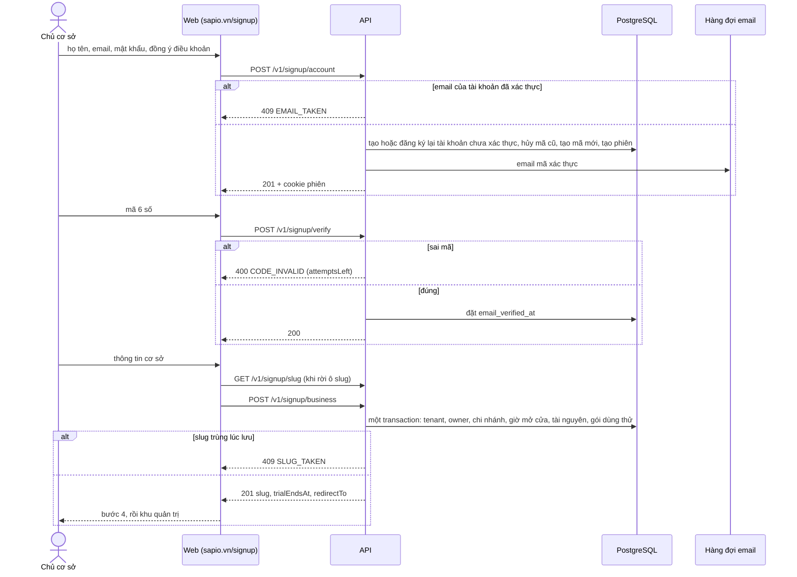
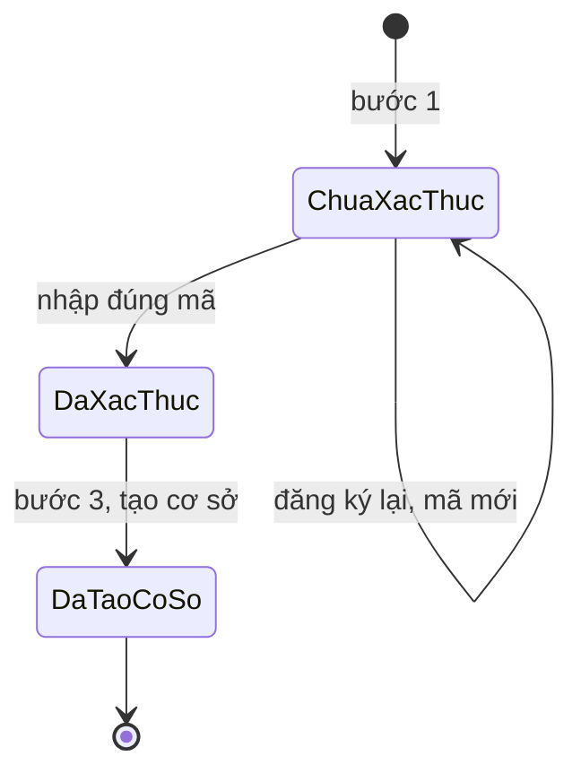

## Phạm vi

| Có trong tính năng này | Ở tính năng khác |
|---|---|
| Đăng ký cơ sở (MH-02), bốn bước: tài khoản, mã xác thực, thông tin cơ sở, đã tạo | Đăng nhập, phiên, quên mật khẩu, mật khẩu BR-73 ([Xác thực nhân sự](./auth.md)) |
| Tài khoản chưa xác thực và đăng ký lại | Đổi slug sau khi tạo (MH-50, BR-72) |
| Mã xác thực email (BR-74) | Kích hoạt gói, hết dùng thử (BR-82 đến BR-85) |
| Tạo cơ sở dùng thử: chi nhánh đầu, giờ mở cửa, tài nguyên mặc định, gói dùng thử (BR-80) | Thêm chi nhánh, nhân viên, dịch vụ (MH-42, MH-47, MH-44) |
| Email gửi mã | Nhận lời mời vào cơ sở có sẵn (MH-05, BR-78) |

## Khái niệm

| Tên | Trong code | Nghĩa |
|---|---|---|
| Tài khoản chưa xác thực | `users.email_verified_at` rỗng | Tài khoản vừa tạo ở bước 1, chưa nhập đúng mã. Nằm chung bảng `users` |
| Mã xác thực | `email_verification` | Mã 6 số gửi tới email ở bước 2 |
| Lần dùng thử | `trial_claim` | Dấu vết một email đã xác thực đã tạo cơ sở dùng thử, khóa theo email (BR-74.19) |
| Cơ sở dùng thử | `tenant` có `subscription.status = trialing` | Cơ sở vừa tạo, gói Chuyên nghiệp (`pro`), 7 ngày (BR-80) |
| Loại tài nguyên mặc định | `resource_type` | Bốn loại có sẵn khi tạo cơ sở: Nhân viên (`is_staff`), Ghế, Giường, Phòng (D-16) |

Email được **chuẩn hóa** như ở [Xác thực nhân sự](./auth.md#khái-niệm): bỏ khoảng trắng hai đầu, đổi sang chữ thường.

## Quy tắc

### Mã xác thực (BR-74.1 đến BR-74.8)

| Mã | Quy tắc |
|---|---|
| BR-74.1 | Mã gồm **6 chữ số**, sinh bằng `crypto`. DB chỉ lưu hash của mã (HMAC-SHA-256 với khóa của máy chủ, vì 6 chữ số dễ dò ngược nếu chỉ băm SHA-256) |
| BR-74.2 | Mã hết hạn sau **10 phút** kể từ lúc gửi |
| BR-74.3 | Mỗi lần gửi mã mới thì mọi mã cũ của tài khoản đó hết hiệu lực |
| BR-74.4 | Nhập sai **3 lần** thì mã đó bị hủy, phải gửi mã mới. Câu báo kèm số lần còn lại: còn 2, còn 1; lần sai thứ 3 báo mã đã bị hủy |
| BR-74.5 | "Gửi lại mã" ở bước 2 dùng được sau **60 giây** kể từ lần gửi trước. Yêu cầu sớm hơn bị từ chối, không gửi gì, và cho biết còn phải chờ bao nhiêu giây. Đăng ký lại ở bước 1 không bị hạn 60 giây này nhưng vẫn bị BR-74.6 |
| BR-74.6 | Tối đa **5 mã mỗi giờ** cho một email, tính cả mã gửi khi đăng ký và đăng ký lại. Quá thì từ chối tới khi mã cũ nhất của giờ đó đủ 1 giờ |
| BR-74.7 | Nhập đúng thì đặt `email_verified_at`, mã được đánh dấu đã dùng, sang bước 3 |
| BR-74.8 | Đăng ký, gửi mã, nhập mã và kiểm slug còn bị giới hạn theo IP. Số lần cụ thể ở [API đăng ký](../api/signup.md#giới-hạn-theo-ip) |

### Tài khoản, bước 1 (BR-74.9 đến BR-74.14)

| Mã | Quy tắc |
|---|---|
| BR-74.9 | Bước 1 nhận họ tên, email, mật khẩu (BR-73) và việc đồng ý điều khoản. Bấm "Tạo tài khoản" thì: tạo tài khoản chưa xác thực, đăng nhập luôn bằng phiên cửa `staff` không giữ đăng nhập (BR-76.9), gửi mã (BR-74.1) |
| BR-74.10 | Email thuộc tài khoản **đã xác thực**: không tạo gì, không gửi mã, báo đã có tài khoản kèm link đăng nhập |
| BR-74.11 | Email thuộc tài khoản **chưa xác thực**: cho đăng ký lại. Thay tên và mật khẩu, thu hồi mọi phiên cũ, hủy mã cũ, gửi mã mới. Nhờ vậy không ai giữ chỗ được email của người khác |
| BR-74.12 | Gửi lại bước 1 khi đang có phiên của tài khoản chưa xác thực thì **sửa chính tài khoản đó**, kể cả khi đổi email ("Sửa email" ở bước 2), không tạo tài khoản mới. Email mới đã thuộc tài khoản khác thì áp BR-74.10 hoặc BR-74.11 cho tài khoản đó |
| BR-74.13 | Phiên của tài khoản chưa xác thực chỉ dùng được cho bước 2: nhập mã, gửi lại mã, đăng xuất, xem phiên. API khác từ chối, kể cả kiểm slug và tạo cơ sở |
| BR-74.14 | Đăng nhập bằng tài khoản chưa xác thực vẫn thành công (BR-76.1 không đổi: lỗi email, mật khẩu báo như cũ), nơi đến là bước 2. Đăng nhập không gửi mã; bước 2 có nút "Gửi lại mã" |

### Thông tin cơ sở, bước 3 (BR-74.15 đến BR-74.22)

| Mã | Quy tắc |
|---|---|
| BR-74.15 | Chỉ vào được bước 3 khi đã đăng nhập, email đã xác thực, và tài khoản chưa từng tạo cơ sở dùng thử |
| BR-74.16 | Bước 3 nhận: tên cơ sở; slug (BR-72); chi nhánh đầu tiên gồm tên, số điện thoại (chuẩn hóa theo BR-61), địa chỉ; giờ mở cửa 7 ngày; số Ghế, Giường, Phòng |
| BR-74.17 | **Giờ mở cửa:** mỗi ngày một khung. Mặc định 08:00 đến 20:00, Chủ Nhật nghỉ. Ít nhất một ngày mở; ngày mở có giờ đóng sau giờ mở. Nghỉ trưa, nhiều khung một ngày và ngày đặc biệt chỉnh sau (BR-02) |
| BR-74.18 | **Tài nguyên:** cơ sở mới có 4 loại mặc định: Nhân viên (`is_staff`), Ghế, Giường, Phòng (D-16). Bước này hỏi số lượng của ba loại không phải nhân viên, mỗi loại từ 0 đến 20, mặc định Ghế 1, Giường 0, Phòng 0. Tài nguyên đặt tên "Ghế 1", "Ghế 2", "Giường 1"... và thuộc chi nhánh đầu tiên. Không tạo tài nguyên nhân viên |
| BR-74.19 | **Mỗi email đã xác thực chỉ tạo được một cơ sở dùng thử** (BR-74). Lần tạo thành công ghi một dòng `trial_claims`, khóa chính là email, kèm `user_id` và `tenant_id`. Email đã có dòng này thì mọi yêu cầu tạo cơ sở bị từ chối `TRIAL_USED`; vi phạm khóa chính của `trial_claims` (hai yêu cầu cùng lúc) cũng trả `TRIAL_USED` |
| BR-74.20 | Bấm "Tạo cơ sở" thì trong **một transaction** tạo: `tenants`, `memberships` vai chủ cơ sở (`owner`), `branches` (múi giờ `Asia/Ho_Chi_Minh`), `opening_hours`, 4 `resource_types`, các `resources`, `subscriptions` trạng thái `trialing` gói `pro`, `trial_claims`, cùng dòng mặc định của `booking_policies` và `tenant_profiles`. Một bước lỗi thì không tạo gì cả |
| BR-74.21 | Slug đã có người dùng lúc lưu (kể cả hai người bấm cùng lúc, hoặc slug nằm trong `tenant_slug_history`) thì báo "đã có cơ sở dùng địa chỉ này", không lỗi 500; không tạo gì và người dùng sửa slug rồi gửi lại. Kiểm slug khi rời ô chỉ là gợi ý: kết quả cuối cùng do lúc lưu quyết định |
| BR-74.22 | Tạo xong thì đặt `users.last_tenant_id` là cơ sở mới |

Bước 3 không có nút "Lưu và làm tiếp sau". Thoát giữa chừng thì lần sau đăng nhập phải điền lại bước 3.

### Ngày hết dùng thử (BR-74.23, theo BR-80)

| Mã | Quy tắc |
|---|---|
| BR-74.23 | `trial_ends_at` là **00:00 của ngày thứ 8**, theo giờ chi nhánh đầu tiên, đổi sang UTC. Ngày tạo là ngày thứ nhất, nên dùng thử hết lúc 23:59:59 ngày thứ 7 (BR-80). Từ đúng `trial_ends_at` trở đi là hết dùng thử. Tính bằng hàm thuần trong domain, lấy giờ từ `Clock`, nhận múi giờ chi nhánh làm tham số |

Ví dụ với múi giờ `Asia/Ho_Chi_Minh`: tạo lúc 23:50 ngày 10/11/2026 (16:50 UTC) hoặc lúc 00:10 cùng ngày (17:10 UTC ngày 09/11) đều cho `trial_ends_at` = 2026-11-16T17:00:00Z, tức 00:00 ngày 17/11. Cộng 7 lần 24 giờ theo UTC sẽ sai ở cả hai trường hợp.

## Bước 4: đã tạo

Màn hình hiện: tên cơ sở; địa chỉ trang đặt lịch (`{slug}.sapio.vn`); ngày cuối dùng thử (ngày thứ 7, hết lúc 23:59); lời nhắc rằng trong dùng thử trang đặt lịch **chưa nhận đặt lịch**, chỉ người đã đăng nhập của cơ sở xem thử được (BR-81); nút vào khu quản trị. Chi tiết ở [màn hình](../screens/signup.md).

## Đường vào

| Từ | Đến |
|---|---|
| Đăng nhập bằng tài khoản chưa xác thực | `/signup?step=verify` (BR-74.14). Dòng tương ứng ở bảng "Vào cơ sở sau khi đăng nhập" của [Xác thực nhân sự](./auth.md#vào-cơ-sở-sau-khi-đăng-nhập-một-phần-của-br-79) |
| "Đăng ký cơ sở của riêng bạn" ở Chọn cơ sở (MH-06), tài khoản đã xác thực và chưa tạo cơ sở dùng thử | Thẳng bước 3. Tài khoản đã tạo rồi thì nút không hiện |
| Mở `/signup` khi đã đăng nhập | Bước xa nhất được phép: chưa xác thực thì bước 2; đã xác thực và chưa tạo cơ sở thì bước 3 |
| Mở `/signup` khi đã tạo cơ sở dùng thử | Chọn cơ sở (MH-06). Bước 4 chỉ hiện ngay sau lần tạo, từ kết quả của yêu cầu tạo |

## Email gửi mã

Gửi qua hàng đợi như các email tài khoản khác. Tiêu đề: **"Mã xác thực email Sapio"**. Nội dung: lời chào, mã 6 số, giờ hết hạn, số lần nhập sai tối đa, nút "Nhập mã" tới bước 2, và dòng "Không phải bạn đăng ký? Bỏ qua email này, tài khoản chưa xác thực không làm được gì." Mẫu ở `mock/account-mail.ts` (`verifyMail`).

## Luồng

## Tiêu chí chấp nhận

Mỗi dòng là ít nhất một test. Tên test bắt đầu bằng mã quy tắc, như ở [Xác thực nhân sự](./auth.md#tiêu-chí-chấp-nhận). Đồng hồ giả dùng `Clock`. Số thứ tự tiếp từ AC-23.

| # | Cho | Khi | Thì | Quy tắc |
|---|---|---|---|---|
| AC-24 | Chưa có tài khoản `an@x.vn` | Bước 1 với ` An@X.vn `, mật khẩu hợp lệ, đã đồng ý điều khoản | 201; có tài khoản `an@x.vn` với `email_verified_at` rỗng; cookie phiên không có `Max-Age`; một email mã xác thực trong Mailpit | BR-74.9 |
| AC-25 | Như AC-24 | Bước 1 mà mật khẩu 14 ký tự / nằm trong danh sách phổ biến / thiếu đồng ý điều khoản | 400 `VALIDATION_FAILED`, `errors[0]` là `password` với `TOO_SHORT` / `TOO_COMMON`, hoặc `acceptTerms`; không tạo tài khoản, không gửi thư | BR-73.1, 73.3, 74.9 |
| AC-26 | Mã vừa gửi lúc 10:00 | Kiểm mã trong DB | Cột `code_hash` không chứa mã 6 số; mã gồm đúng 6 chữ số | BR-74.1 |
| AC-27 | Mã gửi lúc 10:00 | Nhập đúng lúc 10:09:59 / 10:10:00 | 200 / 410 `CODE_EXPIRED` | BR-74.2 |
| AC-28 | Đã gửi mã A, rồi gửi lại thành mã B | Nhập mã A, rồi mã B | Mã A: 410 `CODE_EXPIRED`. Mã B: 200 | BR-74.3 |
| AC-29 | Mã chưa dùng | Nhập sai lần 1, 2, 3 | Lần 1: 400 `CODE_INVALID`, `attemptsLeft = 2`. Lần 2: `attemptsLeft = 1`. Lần 3: `attemptsLeft = 0`. Lần 4 (kể cả đúng mã): 410 `CODE_EXPIRED` | BR-74.4 |
| AC-30 | Mã bị hủy sau 3 lần sai | Gửi lại mã (sau 60 giây) rồi nhập đúng | 202, rồi 200 | BR-74.4 |
| AC-31 | Vừa gửi mã lúc 10:00:00 | Gửi lại lúc 10:00:30, rồi lúc 10:01:00 | Lần 10:00:30: 429 `RESEND_TOO_SOON`, `Retry-After: 30`, không có thư mới. Lần 10:01:00: 202 và có thư | BR-74.5 |
| AC-32 | Đã gửi 5 mã cho một email trong 1 giờ | Gửi mã thứ 6 trong giờ đó; rồi sau khi mã cũ nhất đủ 1 giờ | 429 `CODE_LIMIT_REACHED`, có `Retry-After`; sau đó 202 | BR-74.6 |
| AC-33 | Mã đúng | Nhập đúng | 200; `email_verified_at` có giá trị; nhập lại cùng mã trả 409 `ALREADY_VERIFIED` | BR-74.7 |
| AC-34 | Một IP | Gọi vượt giới hạn của từng endpoint: tạo tài khoản, gửi lại mã, nhập mã, kiểm slug | Yêu cầu vượt hạn nhận 429 `RATE_LIMITED` kèm `Retry-After` | BR-74.8 |
| AC-35 | Email của tài khoản đã xác thực | Bước 1 | 409 `EMAIL_TAKEN`; không có phiên mới, không có thư; mật khẩu và tên của tài khoản đó không đổi | BR-74.10 |
| AC-36 | Tài khoản chưa xác thực `an@x.vn` với tên A, mật khẩu M1, đã có phiên S1 và mã C1 | Người khác (không có phiên) bước 1 với `an@x.vn`, tên B, mật khẩu M2 | 201 và phiên S2. S1 trả 401; M1 không đăng nhập được, M2 đăng nhập được; tên là B; nhập C1 bằng S2 trả 410 `CODE_EXPIRED`; có thư với mã mới | BR-74.11 |
| AC-37 | Đang có phiên của tài khoản chưa xác thực `an@x.vn` | Bước 1 với `an@x.vn` rồi với `an2@x.vn`, họ tên đã điền | Cả hai lần chỉ có một dòng `users`; lần hai đổi email thành `an2@x.vn`, mã cũ bị hủy, thư mã mới tới `an2@x.vn` | BR-74.12 |
| AC-38 | Đang có phiên của tài khoản chưa xác thực `an@x.vn`; `b@x.vn` thuộc tài khoản đã xác thực | Bước 1 với `b@x.vn` | 409 `EMAIL_TAKEN`; tài khoản `an@x.vn` giữ nguyên | BR-74.12 |
| AC-39 | Phiên của tài khoản chưa xác thực | Gọi slug, tạo cơ sở, `GET /v1/auth/workspaces` | Cả ba trả 403 `EMAIL_NOT_VERIFIED`. `GET /v1/auth/session` trả 200 với `emailVerified = false`; đăng xuất trả 204 | BR-74.13 |
| AC-40 | Tài khoản chưa xác thực, mật khẩu đúng | Đăng nhập ở `/v1/auth/login`; rồi nhập sai mật khẩu | 200 với `redirectTo = /signup?step=verify`, không có thư mới; lần sai trả 401 `INVALID_CREDENTIALS` y như tài khoản đã xác thực | BR-74.14, BR-76.1 |
| AC-41 | Tài khoản đã xác thực, chưa tạo cơ sở | Tạo cơ sở với dữ liệu hợp lệ | 201; `GET /v1/auth/workspaces` có cơ sở mới với vai `owner` | BR-74.15 |
| AC-42 | Tài khoản chưa xác thực / chưa đăng nhập | Tạo cơ sở | 403 `EMAIL_NOT_VERIFIED` / 401 `UNAUTHENTICATED`; không có dòng `tenants` mới | BR-74.15 |
| AC-43 | Body tạo cơ sở: tất cả ngày nghỉ / một ngày có giờ đóng bằng hoặc trước giờ mở / Ghế 21 / Giường -1 / slug `signup` / số điện thoại `123` | Tạo cơ sở | 400 `VALIDATION_FAILED`, `errors` chỉ ra đúng trường; không tạo gì | BR-74.16, 74.17, 74.18, BR-72 |
| AC-44 | Tài khoản đủ điều kiện | Tạo cơ sở mà chỉ gửi giờ mở cửa mặc định, Ghế 2, Giường 0, Phòng 1 | Cơ sở có đúng 4 `resource_types`; 3 `resources` tên "Ghế 1", "Ghế 2", "Phòng 1" thuộc chi nhánh đầu; 7 ngày giờ mở cửa với Chủ Nhật không có dòng | BR-74.17, 74.18 |
| AC-45 | Tài khoản đã tạo cơ sở dùng thử | Gửi lại yêu cầu tạo (cùng hoặc khác slug) | 409 `TRIAL_USED`; số `tenants` không đổi | BR-74.19 |
| AC-46 | Cùng một tài khoản (cùng email) | Hai yêu cầu tạo cơ sở chạy cùng lúc | Đúng một yêu cầu 201, yêu cầu kia 409 `TRIAL_USED` (kể cả khi vi phạm khóa chính của `trial_claims`); có đúng một `tenants`, một `trial_claims` | BR-74.19 |
| AC-47 | Tài khoản đủ điều kiện | Tạo cơ sở, rồi đọc DB | Có `tenants`, `memberships` vai `owner`, `branches` với múi giờ `Asia/Ho_Chi_Minh`, `opening_hours`, `resource_types`, `resources`, `subscriptions` (`trialing`, gói `pro`), `trial_claims`, `booking_policies`, `tenant_profiles` | BR-74.20 |
| AC-48 | Tài khoản đủ điều kiện, bước tạo `resources` gây lỗi (chèn lỗi bằng test) | Tạo cơ sở | Lỗi trả về; không có dòng nào của cơ sở này ở bất kỳ bảng nào, kể cả `trial_claims`; gửi lại sau khi hết lỗi thì tạo được | BR-74.20 |
| AC-49 | Cơ sở `toc-may` đã có | Tạo cơ sở với slug `toc-may` | 409 `SLUG_TAKEN`; không tạo gì; tài khoản tạo lại được với slug khác | BR-74.21 |
| AC-50 | Slug `moi-doi` từng thuộc cơ sở (nằm trong `tenant_slug_history`) | Kiểm slug; tạo cơ sở với slug đó | Kiểm slug: `available = false`, `reason = TAKEN`. Tạo: 409 `SLUG_TAKEN` | BR-74.21, BR-72 |
| AC-51 | Hai tài khoản đủ điều kiện | Cùng lúc tạo cơ sở với cùng slug `quan-1` | Đúng một yêu cầu 201, yêu cầu kia 409 `SLUG_TAKEN` (không phải 500); có đúng một `tenants` slug `quan-1`; tài khoản bị từ chối không có `trial_claims` | BR-74.21 |
| AC-52 | Tạo cơ sở thành công | Đọc `users.last_tenant_id` | Bằng id cơ sở mới | BR-74.22 |
| AC-53 | Tạo lúc 23:50 ngày 10/11/2026 giờ Việt Nam (16:50 UTC) | Đọc `subscriptions.trial_ends_at` | 2026-11-16T17:00:00Z | BR-74.23, BR-80 |
| AC-54 | Tạo lúc 00:10 ngày 10/11/2026 giờ Việt Nam (17:10 UTC ngày 09/11) | Đọc `trial_ends_at` | 2026-11-16T17:00:00Z | BR-74.23, BR-80 |
| AC-55 | Cơ sở tạo như AC-53 | Đồng hồ giả chạy tới 2026-11-16T16:59:59Z, rồi 17:00:00Z | Lúc 16:59:59Z còn dùng thử; từ 17:00:00Z hết dùng thử | BR-74.23, BR-80, BR-82 |
| AC-56 | Mã xác thực gửi đi | Đọc thư trong Mailpit | Tiêu đề "Mã xác thực email Sapio"; thân thư có mã 6 số trùng mã vừa tạo | BR-74.1 |

## Liên quan

- Màn hình: [Đăng ký cơ sở](../screens/signup.md), [Danh sách màn hình](../screens/index.md) (MH-02, MH-06)
- API: [Đăng ký cơ sở](../api/signup.md), [Xác thực](../api/auth.md)
- Bảng: `users`, `email_verifications`, `sessions`, `tenants`, `memberships`, `branches`, `opening_hours`, `resource_types`, `resources`, `subscriptions`, `trial_claims` trong [ERD](../architecture/erd.md)
- Quyết định: [D-15](../decisions/d15-trial-and-two-plans.md), [D-16](../decisions/d16-beauty-only-scope.md), [T-16](../decisions/t16-tenant-subdomains.md), [T-17](../decisions/t17-plan-entitlements.md), [T-22](../decisions/t22-signup-email-exposure.md)
