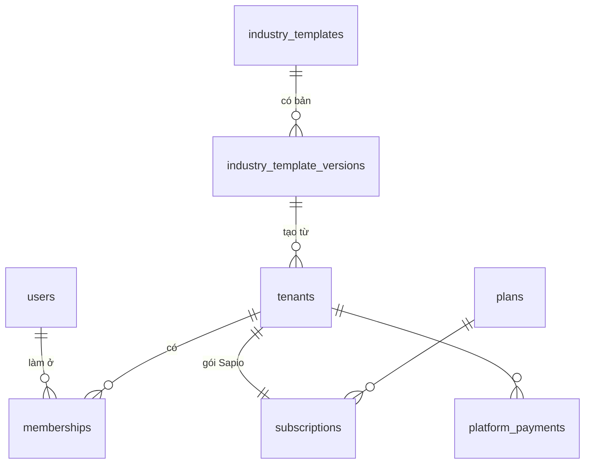
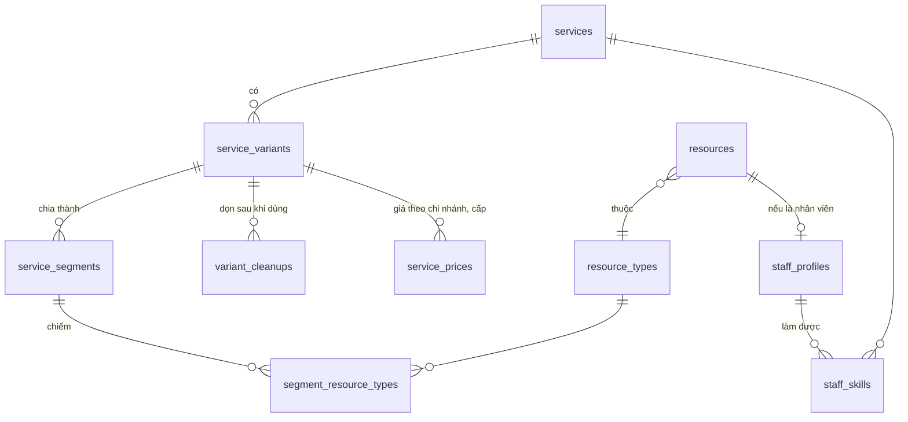
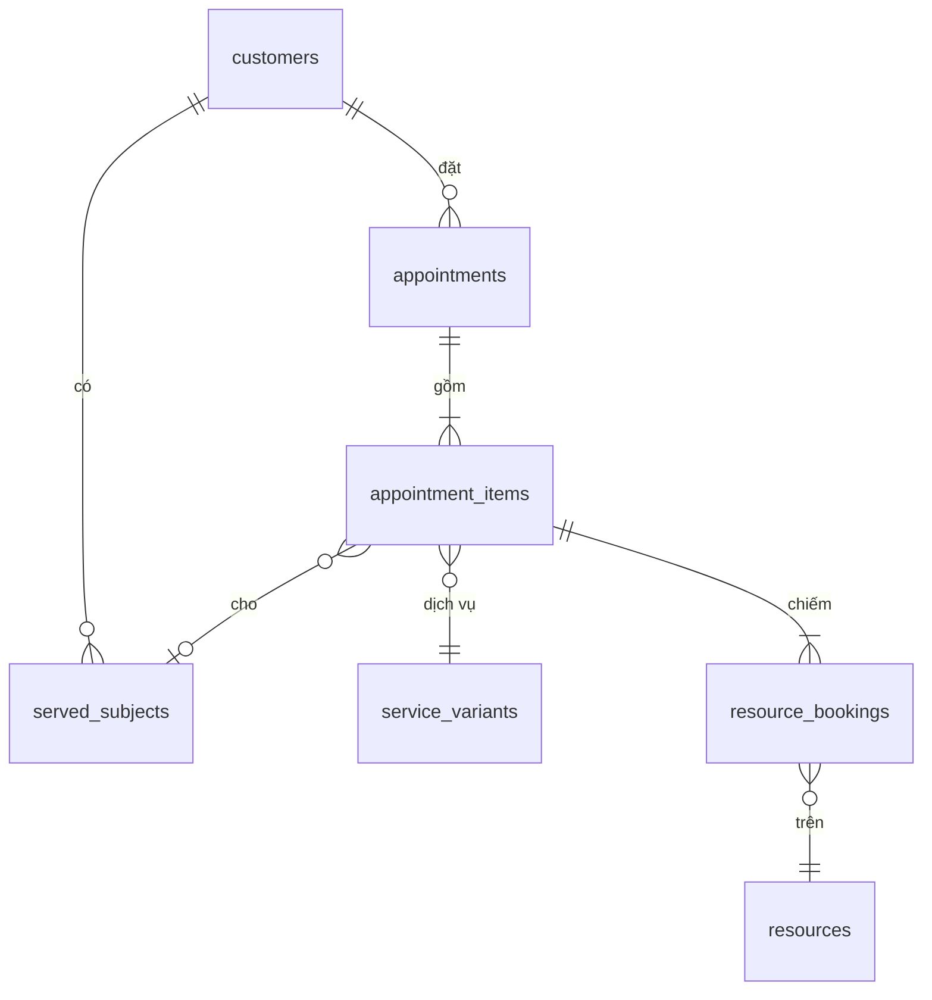

> **Bản 1, 08/11/2026.** Viết theo các quy tắc đã chốt tới BR-88 và các màn đã vẽ. Điểm còn mở ở [mục 13](#13-câu-hỏi-còn-mở). Tên bảng, cột theo [Thuật ngữ](../nghiep-vu/thuat-ngu.md), viết `snake_case` trong DB.

## 1. Quy ước chung

- **Khóa chính:** `id uuid default uuidv7()` (PostgreSQL 18).
- **Đa khách thuê:** mọi bảng nghiệp vụ có `tenant_id uuid not null`, kể cả bảng con (đoạn của dịch vụ, dòng hóa đơn), để RLS chặn ở từng bảng (quy tắc 4, T-07).
- **Khóa ngoại kèm tenant:** mỗi bảng nghiệp vụ có `unique (tenant_id, id)`. Khóa ngoại tham chiếu cặp `(tenant_id, x_id)` chứ không chỉ `x_id`. Vì vậy một dòng của Tóc Mây không thể trỏ sang dịch vụ của Pawpaw, kể cả khi code có lỗi.
- **Thời điểm:** `timestamptz`. Ngày địa phương (`date`) và giờ địa phương (`time`) chỉ dùng cho thứ gắn với lịch của chi nhánh: giờ mở cửa, ngày đặc biệt.
- **Tiền:** `bigint`, đơn vị đồng (quy tắc 1). Cột tiền tên kết thúc bằng `_vnd`.
- **Trạng thái:** `text` kèm `check (status in (...))`, dễ thêm giá trị hơn kiểu `enum` của Postgres. Dữ liệu trạng thái mô tả ở [mục 11](#11-vòng-đời-trạng-thái).
- **Xóa:** cấu hình (dịch vụ, tài nguyên, nhân viên) không xóa cứng khi đã có lịch tham chiếu, mà đặt `archived_at`. Lịch hẹn, tiền, sổ cái, nhật ký không bao giờ xóa.
- **Cột chung:** `created_at timestamptz not null default now()`. Bảng sửa được có thêm `updated_at`. Không liệt kê lại hai cột này trong các bảng dưới đây.
- **JSONB** chỉ dùng cho thứ có hình dạng do ngành quyết định: thuộc tính đối tượng, điều kiện biến thể, nội dung gói cấu hình ngành. Hình dạng được kiểm bằng schema Zod trong `packages/shared` (quy tắc 8, BR-71).

Ký hiệu trong bảng: **PK** khóa chính, **FK** khóa ngoại, **U** duy nhất, **?** cho phép rỗng.

## 2. Nền tảng: tài khoản, khách thuê, gói ngành

Các bảng này **không có RLS theo tenant**: chúng là dữ liệu của nền tảng hoặc phải đọc được trước khi biết tenant (đăng nhập, chọn cơ sở).

| Bảng | Cột chính | Ràng buộc, ghi chú |
|---|---|---|
| `users` | `email citext`, `password_hash`, `name`, `email_verified_at?`, `is_platform_admin bool` | U `email`. Tài khoản nhân sự, dùng chung cho mọi cơ sở (một người làm ở hai cơ sở có một tài khoản) |
| `sessions` | `user_id` FK, `token_hash`, `expires_at`, `revoked_at?`, `ip`, `user_agent` | U `token_hash`. Phiên nhân sự (T-08) |
| `email_verifications` | `email`, `code_hash`, `purpose` (`signup`, `reset_password`), `expires_at`, `attempts`, `consumed_at?` | Mã 6 số của đăng ký và quên mật khẩu |
| `industry_templates` | `code` (`hair_salon`, `pet_spa`), `name`, `status` (`open`, `soon`, `hidden`), `card_description` | U `code` |
| `industry_template_versions` | `template_id` FK, `version int`, `content jsonb`, `published_at?`, `published_by?` | U `(template_id, version)`. `published_at` rỗng là bản nháp; mỗi gói tối đa một bản nháp (unique một phần). `content` gồm từ ngữ, schema đối tượng, loại tài nguyên, dịch vụ mẫu có đoạn, chính sách mặc định (BR-70, MH-59) |
| `tenants` | `slug citext`, `name`, `monogram`, `template_version_id` FK, `locked_at?`, `lock_reason?`, `created_by` FK `users` | U `slug` (BR-72). `template_version_id` ghi cơ sở được tạo từ bản nào; sau đó không đọc gói nữa (BR-70). Khóa vi phạm là `locked_at` (BR-75) |
| `tenant_slug_history` | `tenant_id`, `slug`, `changed_at` | U `slug`. Link cũ tự chuyển sang slug mới (BR-72) |
| `trial_claims` | `email citext` PK, `tenant_id`, `claimed_at` | Một email đã xác thực chỉ dùng thử một lần (BR-74) |
| `plans` | `code`, `name`, `monthly_price_vnd`, `features text[]`, `limits jsonb` | Như [T-17](../ky-thuat/quyet-dinh-ky-thuat.md#t-17-gói-sapio-gói-và-tính-năng-là-dữ-liệu-kiểm-qua-một-hàm) |
| `subscriptions` | `tenant_id` U, `plan_code`, `status`, `trial_ends_at?`, `current_period_end?`, `pending_plan_code?` | Như T-17 |
| `platform_payments` | `tenant_id`, `provider_ref` U, `kind` (`buy`, `renew`, `upgrade`), `plan_code`, `months`, `amount_vnd`, `paid_at` | Chỉ thêm (BR-88) |

**Thành viên** cần cả hai phía: biết tenant để RLS chặn, và liệt kê được mọi cơ sở của một tài khoản lúc đăng nhập.

| Bảng | Cột chính | Ràng buộc, ghi chú |
|---|---|---|
| `memberships` | `tenant_id`, `user_id` FK, `role` (`owner`, `manager`, `receptionist`, `technician`), `branch_id?`, `staff_resource_id?`, `disabled_at?` | U `(tenant_id, user_id)`. Có RLS. Màn "Chọn cơ sở" (MH-06) đọc qua hàm `memberships_of(user_id)` kiểu `SECURITY DEFINER`, chỉ trả slug, tên, vai trò |
| `invitations` | `tenant_id`, `email`, `role`, `token_hash`, `expires_at`, `accepted_at?` | MH-05 |



## 3. Cấu hình cơ sở: chi nhánh, giờ mở cửa, chính sách

| Bảng | Cột chính | Ràng buộc, ghi chú |
|---|---|---|
| `tenant_profiles` | `tenant_id` PK, `vocabulary jsonb`, `subject_schema jsonb`, `brand_color`, `logo_url?` | Chép từ gói ngành lúc tạo (BR-70). Sửa ở đây không đụng gói gốc |
| `booking_policies` | `tenant_id` PK, `min_lead_minutes`, `max_days_ahead`, `change_cutoff_minutes`, `max_reschedules`, `no_show_after_minutes`, `deposit_after_no_shows`, `hold_minutes` (10), `otp_ttl_minutes`, `otp_max_attempts`, `refund_rules jsonb` | Các tham số X, Y, N, M, K của BR-06 đến BR-10, BR-16, BR-23. Mặc định lấy từ gói ngành |
| `branches` | `tenant_id`, `name`, `address`, `phone`, `timezone` (`Asia/Ho_Chi_Minh`), `slot_step_minutes` (15), `archived_at?` | BR-58. Gói Cơ bản chỉ 1 chi nhánh đang dùng (BR-83) |
| `opening_hours` | `tenant_id`, `branch_id` FK, `weekday smallint`, `opens time`, `closes time` | Nhiều dòng mỗi ngày là nhiều khung (sáng, chiều). `check (opens < closes)` |
| `special_days` | `tenant_id`, `branch_id` FK, `date`, `note` | U `(branch_id, date)`. Ngày đặc biệt thay giờ thường lệ (BR-02) |
| `special_day_hours` | `tenant_id`, `special_day_id` FK, `opens`, `closes` | Không có dòng nào là đóng cả ngày |

Khung giờ trong cùng một ngày không được chồng nhau. Ràng buộc này kiểm ở tầng ứng dụng, vì hai cột `time` không dựng được exclusion constraint gọn gàng.

## 4. Tài nguyên và nhân sự

Nhân viên là một **tài nguyên** có loại `is_staff` (thuật ngữ). Mọi thứ chiếm giờ, kể cả người, nằm chung bảng `resources`, để thuật toán giờ trống và exclusion constraint chỉ cần một bảng.

| Bảng | Cột chính | Ràng buộc, ghi chú |
|---|---|---|
| `resource_types` | `tenant_id`, `name`, `is_staff bool`, `sort` | Từ gói ngành: Thợ, Ghế cắt, Giường gội; Nhân viên chăm sóc, Bồn tắm, Lồng sấy, Bàn cắt tỉa |
| `resources` | `tenant_id`, `branch_id` FK, `resource_type_id` FK, `name`, `sort`, `archived_at?` | Ghế 1, Lồng sấy 2, Mai |
| `resource_pauses` | `tenant_id`, `resource_id` FK, `starts_at`, `ends_at`, `reason` | Tạm ngưng bảo trì (MH-46). Trừ khỏi thời gian khả dụng |
| `staff_levels` | `tenant_id`, `level smallint`, `name` | U `(tenant_id, level)`. Thợ, Thợ chính, Thợ cả (BR-56) |
| `staff_profiles` | `tenant_id`, `resource_id` PK FK, `display_name`, `title`, `specialty?`, `avatar_url?`, `bookable_online bool`, `full_name`, `employee_code`, `phone`, `level smallint` | Hai lớp công khai, nội bộ (BR-15). FK `(tenant_id, level)` sang `staff_levels`. Tài nguyên phải có loại `is_staff` (trigger kiểm) |
| `staff_skills` | `tenant_id`, `staff_resource_id` FK, `service_id` FK | PK `(staff_resource_id, service_id)` (BR-03) |
| `shifts` | `tenant_id`, `resource_id` FK, `starts_at`, `ends_at` | Exclusion: một người không có hai ca chồng nhau. Dùng `timestamptz` nên ca qua nửa đêm không cần xử lý riêng (T-05) |
| `leave_requests` | `tenant_id`, `resource_id` FK, `starts_at`, `ends_at`, `reason`, `status`, `decided_by?`, `decided_at?` | BR-11. Chỉ đơn `approved` mới trừ khỏi thời gian khả dụng |

## 5. Dịch vụ

Đây là phần MH-45 và [thuật toán giờ trống](../ky-thuat/thuat-toan-gio-trong.md) đọc.

| Bảng | Cột chính | Ràng buộc, ghi chú |
|---|---|---|
| `service_groups` | `tenant_id`, `name`, `sort` | Cắt, Nhuộm và uốn |
| `services` | `tenant_id`, `group_id?` FK, `name`, `description?`, `deposit_vnd?`, `variant_selection` (`customer`, `subject`), `bookable_online bool`, `commission_split jsonb?`, `sort`, `archived_at?` | BR-55. `commission_split` khi dịch vụ cần hai loại nhân viên (BR-43, [mục 13](#13-câu-hỏi-còn-mở)) |
| `service_variants` | `tenant_id`, `service_id` FK, `name`, `short_name`, `price_vnd`, `match jsonb`, `sort`, `archived_at?` | `price_vnd` là giá gốc. `match` là điều kiện theo thuộc tính đối tượng, rỗng khi khách tự chọn (BR-13). Kiểm phủ đủ, không trùng ở tầng ứng dụng (BR-55) |
| `service_segments` | `tenant_id`, `variant_id` FK, `position smallint`, `kind` (`prep`, `work`, `wait`), `minutes`, `label?` | U `(variant_id, position)`. `check (minutes > 0)`. Chuẩn bị chỉ đứng đầu (BR-50), kiểm bằng trigger |
| `segment_resource_types` | `tenant_id`, `segment_id` FK, `resource_type_id` FK | PK cặp hai cột. Đoạn `wait` không có loại `is_staff` (BR-50, trigger) |
| `variant_cleanups` | `tenant_id`, `variant_id` FK, `resource_type_id` FK, `minutes` | PK `(variant_id, resource_type_id)`. Dọn dẹp sau khi dùng (BR-52) |
| `service_prices` | `tenant_id`, `variant_id` FK, `branch_id?`, `level?`, `price_vnd` | U `(variant_id, branch_id, level)` (coi rỗng là một giá trị: `nulls not distinct`). Giá theo chi nhánh và theo cấp. Giá áp dụng là dòng cụ thể nhất: chi nhánh và cấp, rồi cấp, rồi chi nhánh, rồi `price_vnd` |

Một biến thể có mẫu chiếm dụng tính được hoàn toàn từ `service_segments`, `segment_resource_types` và `variant_cleanups` (thuật toán, mục 2.2). Không lưu sẵn kết quả tính.



## 6. Khách hàng và đối tượng được phục vụ

| Bảng | Cột chính | Ràng buộc, ghi chú |
|---|---|---|
| `customers` | `tenant_id`, `name`, `call_name?`, `phone_e164?`, `email citext?`, `email_verified_at?`, `data_consent_at?`, `marketing_consent_at?`, `requires_deposit bool` | U `(tenant_id, phone_e164)` và U `(tenant_id, email)`, cả hai bỏ qua giá trị rỗng. Cùng số ở hai cơ sở là hai dòng (BR-60). Số điện thoại chuẩn hóa trước khi lưu (BR-61). Đồng ý dữ liệu và quảng cáo tách riêng (BR-64). `requires_deposit` tính lại mỗi lần đánh dấu không đến (BR-10) |
| `customer_notes` | `tenant_id`, `customer_id` FK, `body`, `author_id` | Chỉ trả về ở API nội bộ, không có đường nào ra trang khách (BR-62) |
| `served_subjects` | `tenant_id`, `customer_id` FK, `is_self bool`, `name`, `attributes jsonb`, `archived_at?` | Mỗi khách tối đa một dòng `is_self` (unique một phần). `attributes` hợp lệ theo `tenant_profiles.subject_schema` (BR-71). Lõi chỉ biết "chính khách" hay "đối tượng khác", không biết "thú cưng" (quy tắc 5) |
| `customer_sessions` | `tenant_id`, `customer_id` FK, `token_hash`, `expires_at`, `revoked_at?` | Phiên khách gắn với một cơ sở (T-08, BR-17) |
| `otp_requests` | `tenant_id`, `email`, `code_hash`, `expires_at`, `attempts`, `consumed_at?`, `appointment_id?` | BR-16. Sai quá N lần thì phải gửi mã mới |

## 7. Đặt lịch

Ba tầng: **lịch hẹn** (một lần khách đến), **mục** (một dịch vụ cho một đối tượng), **đặt chỗ tài nguyên** (một đoạn trên một tài nguyên cụ thể).

| Bảng | Cột chính | Ràng buộc, ghi chú |
|---|---|---|
| `appointments` | `tenant_id`, `branch_id` FK, `customer_id?` FK, `status`, `channel` (`online`, `walk_in`, `phone`, `chatbot`), `starts_at`, `ends_at`, `hold_expires_at?`, `deposit_vnd?`, `reschedule_count`, `checked_in_at?`, `completed_at?`, `cancelled_at?`, `cancel_reason?`, `cancelled_by` (`customer`, `tenant`)?, `note?` | `starts_at`, `ends_at` là phần khách thấy (BR-51). `customer_id` rỗng khi đang giữ chỗ mà khách chưa nhập liên hệ |
| `appointment_items` | `tenant_id`, `appointment_id` FK, `position`, `variant_id` FK, `served_subject_id?` FK, `staff_resource_id` FK, `staff_choice` (`any`, `chosen`), `price_vnd`, `starts_at`, `ends_at` | `price_vnd` chốt lúc đặt (BR-12, BR-56). `staff_choice` để biết khách chọn đích danh hay không (BR-11, câu hỏi mở cũ về đổi người) |
| `resource_bookings` | `tenant_id`, `item_id` FK, `resource_id` FK, `kind` (`prep`, `work`, `wait`, `cleanup`), `starts_at`, `ends_at`, `status` (`hold`, `active`, `released`), `expires_at?` | Exclusion constraint chống trùng ([mục 10](#10-ràng-buộc-quan-trọng)). Thời gian thật của từng đoạn được lưu ở đây, nên sửa dịch vụ sau đó không làm đổi lịch đã đặt (BR-59) |

**Giữ chỗ không có bảng riêng.** Roadmap mục 8.1 có `holds`. Mô hình này thay nó bằng lịch hẹn trạng thái `held` cộng các `resource_bookings` trạng thái `hold` có `expires_at`, đúng như BT2 mô tả. Một bảng ít hơn, và lúc xác nhận chỉ đổi trạng thái, không chép dữ liệu.

Vì sao `kind` có `cleanup` dù dịch vụ không có loại đoạn này: dọn dẹp khai theo loại tài nguyên (BR-52). Khi đặt lịch thì nó thành một đoạn thật trên một tài nguyên thật, lịch lễ tân cần vẽ nó (`.sp-appt__seg--buffer`).



## 8. Tiền: hóa đơn, thanh toán, sổ cái, gói, hoa hồng

### 8.1. Hóa đơn và thanh toán

| Bảng | Cột chính | Ràng buộc, ghi chú |
|---|---|---|
| `invoices` | `tenant_id`, `branch_id`, `number`, `customer_id?`, `appointment_id?` U, `status` (`draft`, `issued`, `void`), `subtotal_vnd`, `discount_vnd`, `total_vnd`, `issued_at?` | U `(tenant_id, number)`. Một lịch hẹn tối đa một hóa đơn |
| `invoice_lines` | `tenant_id`, `invoice_id` FK, `kind` (`service`, `product`, `package_sale`, `wallet_topup`, `package_use`, `deposit_applied`, `discount`), `item_id?`, `description`, `quantity`, `unit_price_vnd`, `amount_vnd`, `staff_resource_id?` | Giảm giá theo thứ tự BR-22 là các dòng `discount` |
| `promotions` | `tenant_id`, `name`, `kind` (`percent`, `amount`), `value`, `applies_to jsonb`, `auto bool`, `starts_at`, `ends_at?` | BR-22 |
| `vouchers` | `tenant_id`, `code`, `promotion_id` FK, `max_uses?`, `used_count` | U `(tenant_id, code)`. Tối đa một voucher mỗi hóa đơn (kiểm ở ứng dụng) |
| `payments` | `tenant_id`, `invoice_id?`, `appointment_id?`, `purpose` (`deposit`, `invoice`, `wallet_topup`), `method` (`cash`, `transfer`, `card`, `wallet`, `gateway`), `amount_vnd`, `status`, `provider?`, `provider_ref?`, `idempotency_key`, `paid_at?` | U `(tenant_id, idempotency_key)`, U `(provider, provider_ref)` (BR-21). Thanh toán kết hợp là nhiều dòng cho một hóa đơn |
| `refunds` | `tenant_id`, `payment_id` FK, `amount_vnd`, `reason`, `status`, `requested_by`, `approved_by?`, `approved_at?` | Lý do bắt buộc, cần quyền quản lý (BR-28). Mức hoàn cọc tính theo `booking_policies.refund_rules` (BR-23, BR-24) |

### 8.2. Sổ cái

Sổ cái kép: mỗi giao dịch có ít nhất hai bút toán, tổng bằng 0.

| Bảng | Cột chính | Ràng buộc, ghi chú |
|---|---|---|
| `ledger_accounts` | `tenant_id`, `kind`, `customer_id?`, `staff_resource_id?`, `customer_package_id?` | `kind`: `cash`, `customer_wallet_real`, `customer_wallet_bonus`, `deferred_revenue`, `revenue`, `commission_payable`, `refund_payable` |
| `ledger_transactions` | `tenant_id`, `kind`, `ref_type`, `ref_id`, `idempotency_key`, `commission_period_id?` | U `(tenant_id, idempotency_key)` |
| `ledger_entries` | `tenant_id`, `transaction_id` FK, `account_id` FK, `amount_vnd` (có dấu), `reverses_entry_id?` | Chỉ thêm: trigger chặn `UPDATE`, `DELETE` (quy tắc 6, BR-20). Ràng buộc hoãn tới cuối transaction: tổng `amount_vnd` mỗi giao dịch bằng 0 |

Số dư ví là tổng bút toán của tài khoản, không có cột số dư để sửa (BR-20). Tiền thật và tiền tặng là hai tài khoản riêng, nên rút ví chỉ rút được tài khoản tiền thật (BR-25).

### 8.3. Gói liệu trình

| Bảng | Cột chính | Ràng buộc, ghi chú |
|---|---|---|
| `packages` | `tenant_id`, `name`, `variant_id` FK, `sessions`, `price_vnd`, `valid_days`, `archived_at?` | |
| `customer_packages` | `tenant_id`, `customer_id`, `package_id`, `sessions_total`, `unit_price_vnd`, `purchased_at`, `expires_at`, `status` | `unit_price_vnd` là giá lẻ lúc mua, dùng cho BR-27 |
| `package_usages` | `tenant_id`, `customer_package_id` FK, `item_id` U, `used_at`, `reversed_at?` | Mỗi lần dùng một dòng. Số buổi còn = `sessions_total` − số dòng chưa đảo. Mỗi lần dùng ghi bút toán chuyển `deferred_revenue` sang `revenue` (BR-26) |

### 8.4. Hoa hồng

| Bảng | Cột chính | Ràng buộc, ghi chú |
|---|---|---|
| `commission_rules` | `tenant_id`, `service_id?`, `staff_resource_id?`, `level?`, `kind` (`percent`, `amount`), `value`, `effective_from date` | Quy tắc cụ thể nhất thắng. Chỉ áp cho dịch vụ hoàn thành từ ngày hiệu lực (BR-41). Tính trên số thực thu sau giảm giá (BR-40) |
| `commission_periods` | `tenant_id`, `starts_on`, `ends_on`, `status` (`open`, `closed`), `closed_at?` | Exclusion: các kỳ không chồng ngày. Kỳ đã chốt không nhận bút toán mới; điều chỉnh vào kỳ mở kế tiếp (BR-42) |

Hoa hồng là bút toán vào tài khoản `commission_payable` của từng nhân viên, gắn `commission_period_id`. Hoàn tiền sinh bút toán đảo (BR-28).

## 9. Hệ thống

| Bảng | Cột chính | Ràng buộc, ghi chú |
|---|---|---|
| `outbox_events` | `tenant_id`, `type`, `payload jsonb`, `available_at`, `processed_at?`, `attempts`, `last_error?` | Ghi cùng transaction với thay đổi nghiệp vụ; worker lấy bằng `FOR UPDATE SKIP LOCKED` (T-09) |
| `notifications` | `tenant_id`, `channel` (`email`), `to`, `template`, `payload`, `status`, `sent_at?`, `dedupe_key` | U `(tenant_id, dedupe_key)`: nhắc 24h và 2h không gửi hai lần |
| `audit_logs` | `tenant_id?`, `actor_user_id?`, `action`, `target_type`, `target_id`, `data jsonb`, `at` | Chỉ thêm. Hoàn tiền, xuất danh sách khách, đổi giá (BR-63); khóa, mở khóa, gia hạn thủ công (BR-75) |
| `chat_sessions` | `tenant_id`, `customer_id?`, `appointment_id?`, `status`, `handed_off_at?` | BT7 |
| `chat_messages` | `tenant_id`, `session_id` FK, `role`, `content`, `tool_name?`, `tool_payload jsonb?` | |

## 10. Ràng buộc quan trọng

**Chống trùng lịch (BR-01, BT2):**

```sql
alter table resource_bookings add constraint resource_bookings_no_overlap
  exclude using gist (
    tenant_id with =,
    resource_id with =,
    tstzrange(starts_at, ends_at, '[)') with &&
  ) where (status in ('hold', 'active'));
```

- Ràng buộc không đọc được `now()`. Nên trong transaction giữ chỗ, ứng dụng xóa các `hold` đã quá `expires_at` của đúng các tài nguyên sắp dùng, rồi mới insert. Job định kỳ dọn phần còn lại (BR-07).
- `shifts` và `commission_periods` có exclusion constraint cùng kiểu.

**Khóa ngoại kèm tenant:** ví dụ

```sql
alter table appointment_items add constraint appointment_items_appointment_fk
  foreign key (tenant_id, appointment_id) references appointments (tenant_id, id);
```

**Trigger** (viết bằng migration SQL tùy chỉnh, có test, T-06):
- `ledger_entries`, `audit_logs`, `platform_payments`, `package_usages`: chặn `UPDATE`, `DELETE`. Riêng `reversed_at` của `package_usages` được phép đặt một lần.
- `ledger_transactions`: tổng bút toán bằng 0, kiểm lúc commit.
- `service_segments`: chuẩn bị chỉ đứng đầu. `segment_resource_types`: đoạn chờ không có loại nhân viên.
- `staff_profiles`: tài nguyên phải thuộc loại `is_staff`.
- `appointment_items.staff_resource_id`: người đó có kỹ năng làm dịch vụ (BR-03). Kiểm ở ứng dụng, trigger chặn lần cuối.

**Chỉ mục chính:**
- `resource_bookings (tenant_id, resource_id, starts_at)`: tính giờ trống.
- `appointments (tenant_id, branch_id, starts_at)`: lịch lễ tân.
- `customers (tenant_id, phone_e164)`, `(tenant_id, lower(name) text_pattern_ops)`: tìm khách.
- `outbox_events (available_at) where processed_at is null`.

**RLS:** mọi bảng ở mục 3 đến 9 bật `ENABLE` và `FORCE ROW LEVEL SECURITY`, policy theo `app.tenant_id` (T-07). Cùng áp cho `memberships`, `invitations`. Bảng mục 2 (trừ hai bảng đó) không có RLS; `app_user` chỉ có quyền đọc trên `plans`, `industry_templates`, `industry_template_versions`, còn ghi thì chỉ qua API quản trị nền tảng.

## 11. Vòng đời trạng thái

**Lịch hẹn (`appointments.status`):**

| Từ | Sang | Khi nào | Đặt chỗ tài nguyên |
|---|---|---|---|
| (mới) | `held` | Khách chọn giờ trên trang khách | `hold`, hết hạn sau 10′ |
| `held` | `awaiting_deposit` | Khách đã xác thực OTP, dịch vụ cần cọc | vẫn `hold`, gia hạn tới hết thời gian trả cọc |
| `held`, `awaiting_deposit` | `confirmed` | Xác thực OTP (không cọc) hoặc đã nhận cọc | `active` |
| `held`, `awaiting_deposit` | `expired` | Quá hạn giữ chỗ | `released` |
| (mới) | `confirmed` | Lễ tân tạo tại quầy | `active` |
| `confirmed` | `checked_in` | Lễ tân check-in | `active` |
| `checked_in` | `in_service` | Kỹ thuật viên bắt đầu (MH-35) | `active` |
| `checked_in`, `in_service` | `completed` | Xong dịch vụ; sinh sự kiện outbox | `active` (lịch sử) |
| `confirmed` | `no_show` | Quá M phút chưa check-in (BR-09) | `released` |
| `held`, `awaiting_deposit`, `confirmed` | `cancelled` | Khách hoặc cơ sở hủy | `released` |

Đổi giờ không đổi trạng thái: các `resource_bookings` cũ thành `released`, dòng mới `active` được thêm trong cùng transaction, `reschedule_count` tăng (BR-08).

**Thanh toán:** `initiated → pending → succeeded | failed | expired`. Hoàn tiền là bảng riêng: `requested → approved → done`, hoặc `requested → rejected`.

**Gói của khách:** `active → used_up | expired | refunded`.

**Nghỉ phép:** `pending → approved | rejected`. Chỉ duyệt được khi mọi lịch bị ảnh hưởng đã xử lý (BR-11).

**Kỳ hoa hồng:** `open → closed`.

**Gói Sapio:** như T-17.

## 12. Mỗi quy tắc nằm ở đâu

Tiêu chí của giai đoạn 1: mọi BR có chỗ đứng trong ERD.

| BR | Chỗ đứng |
|---|---|
| BR-01 | Exclusion constraint trên `resource_bookings` |
| BR-02 | `opening_hours`, `special_days`, `special_day_hours` |
| BR-03 | `staff_skills`; trigger trên `appointment_items` |
| BR-04, BR-05, BR-50 đến BR-54 | `service_segments`, `segment_resource_types`, `variant_cleanups`; `resource_bookings.kind` |
| BR-06 đến BR-10 | `booking_policies`; `appointments.status`, `reschedule_count`; `customers.requires_deposit` |
| BR-11 | `leave_requests`; `appointment_items.staff_choice` |
| BR-12, BR-59 | `appointment_items.price_vnd`; thời gian nằm ở `resource_bookings` |
| BR-13, BR-55 | `services.variant_selection`, `service_variants.match`, `served_subjects.attributes` |
| BR-14, BR-15 | `staff_profiles` (`bookable_online`, hai lớp hồ sơ) |
| BR-16, BR-17 | `otp_requests`, `customer_sessions` |
| BR-20, BR-21, BR-25 | `ledger_*`; unique `idempotency_key`; hai tài khoản ví |
| BR-22 | `promotions`, `vouchers`, dòng `discount` |
| BR-23, BR-24, BR-28 | `booking_policies.refund_rules`, `appointments.cancelled_by`, `refunds` |
| BR-26, BR-27 | `package_usages`, `customer_packages.unit_price_vnd` |
| BR-40 đến BR-43 | `commission_rules`, `commission_periods`, `services.commission_split` |
| BR-56, BR-57 | `service_prices`, `staff_levels`, `staff_profiles.level`; `appointment_items.staff_choice` |
| BR-58 | `branches.slot_step_minutes` |
| BR-60, BR-61 | unique `(tenant_id, phone_e164)` |
| BR-62 | `customer_notes` |
| BR-63, BR-75 | `audit_logs`; `tenants.locked_at` |
| BR-64 | `customers.data_consent_at`, `marketing_consent_at` |
| BR-70, BR-71 | `industry_template_versions`, `tenants.template_version_id`, `tenant_profiles` |
| BR-72 | unique `tenants.slug`, `tenant_slug_history` |
| BR-73 | `users.password_hash` (kiểm lúc đặt) |
| BR-74 | `trial_claims` |
| BR-80 đến BR-88 | `plans`, `subscriptions`, `platform_payments` (T-17) |

Không bảng nào dành riêng cho một ngành. Hai gói Salon tóc và Spa thú cưng chỉ khác nhau ở `industry_template_versions.content` (tiêu chí của BT8).

## 13. Câu hỏi còn mở

Mỗi câu có đề xuất. Khi chốt thì chuyển thành BR.

1. **Gộp đối tượng sau OTP.** Khách chưa có phiên khai bé "Mochi" mới (BR-17). Xác thực OTP xong thì hóa ra khách đã có "Mochi" từ trước.
   - *Đề xuất:* không tự gộp. Đối tượng mới gắn vào khách đã nhận diện. Hồ sơ khách (MH-33) gợi ý "Có thể trùng: Mochi (Chó, 6 kg)", lễ tân bấm gộp: lịch của bản trùng chuyển sang bản giữ lại.
2. **Nhận diện khách khi số điện thoại và email lệch nhau.** Email đã xác thực trỏ tới khách A, số điện thoại trùng khách B.
   - *Đề xuất:* email đã xác thực thắng, vì đó là thứ vừa được chứng minh. Số điện thoại mới được lưu cho khách A nếu A chưa có số. Nếu A đã có số khác thì ghi chú cho lễ tân, không tự đổi.
3. **Bỏ kỹ năng khi nhân viên còn lịch sắp tới cho dịch vụ đó.**
   - *Đề xuất:* cho bỏ. Hiện danh sách lịch bị ảnh hưởng, xử lý như nghỉ phép (BR-11): khách chọn đích danh thì hỏi ý, "Bất kỳ ai" thì hệ thống tự xếp người khác.
4. **Dịch vụ cần hai nhân viên** (BR-43). Mô hình cho phép một đoạn chiếm hai loại nhân viên (Thợ chính, Thợ phụ), mỗi loại một người. Khi đó mục lịch hẹn có hai người: `appointment_items.staff_resource_id` chỉ giữ người của loại đầu tiên, người còn lại lấy từ `resource_bookings`.
   - *Đề xuất:* chấp nhận cách này cho đồ án. Hoa hồng chia theo `services.commission_split`.
5. **Giữ chỗ khi lễ tân đặt tại quầy** (câu hỏi mở cũ).
   - *Đề xuất:* không giữ chỗ. Lễ tân tạo thẳng lịch `confirmed`, exclusion constraint vẫn chặn trùng.
